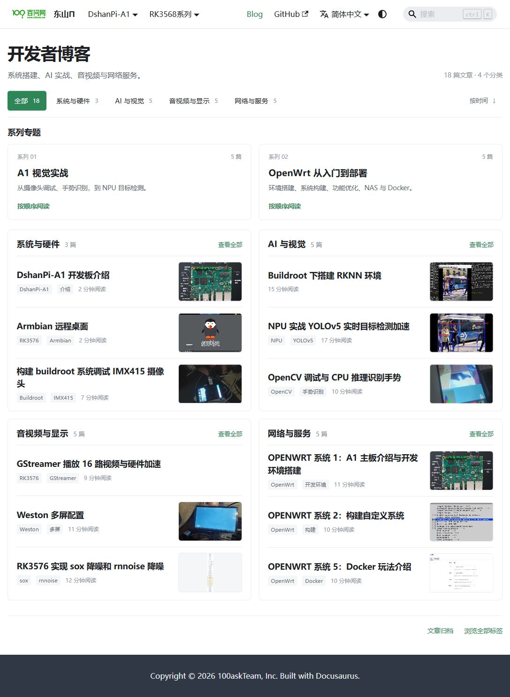

# 博客分类首页 UI 设计

更新日期：2026 年 11 月 13 日。状态：已在本地实现。入口：[博客首页](http://127.0.0.1:3576/blog)。

博客首页按技术主题组织文章，让读者先选择想做的事情，再进入具体文章或连续教程。当前中文博客有 18 篇文章，适合设置四个主分类和两个系列入口。沿用现有绿色品牌色与站点导航，主要调整首页内容结构和阅读密度。

## 当前实现与设计参考

最终配色复用网站现有的 Infima 变量：浅色模式为白底、原有文字灰和主题绿 `#2e8555`；暗色模式沿用原有主题。分类和系列采用文字列表与细边框，不使用早期概念图中的装饰插图及大面积绿底。页面只保留顶部导航原有的全站搜索。

文章行右侧已接入原文真实配图：18 篇中 16 篇有图，GStreamer 与 gmrender 两篇保留纯文字。分类总览使用 136 × 84 的缩略图，完整列表使用 200 × 124，手机缩为 88 × 66；图片按需加载。总览标题由 0.95rem 放大至 1.1rem，列表标题由 1.05rem 放大至 1.2rem，系列与分类卡片间距收紧至 1rem。缩略图来源记录在配置中，文章正文图片保持原样。

[查看改版前页面](images/blog-before.jpg) · [第一轮历史概念](images/blog-overview-v1.png) · [移除重复搜索后的历史概念](images/blog-overview-v2.png) · [第二轮修改提示词](blog-ui-prompt-v2.txt)

## 页面结构与设计理由

| 区域 | 方案 | 读者收益 |
| --- | --- | --- |
| 全站导航 | 保留品牌、产品导航、Blog、GitHub、语言、主题和原有全站搜索 | 全站统一搜索入口 |
| 页头 | 开发者博客标题、简短描述、文章及分类数量 | 一眼理解页面用途 |
| 分类导航 | 全部、系统与硬件、AI 与视觉、音视频与显示、网络与服务，带数量 | 通过主题缩小阅读范围 |
| 系列专题 | A1 视觉实战、OpenWrt 从入门到部署，各 5 篇 | 连续内容按学习顺序阅读 |
| 分类内容 | 宽屏两列四个分类分区，每类先显示 3 篇代表文章；“查看全部”进入该类 | 在一个总览内比较各主题，降低滚动成本 |
| 文章条目 | 标题、技术标签、阅读时长；完整列表提供摘要和已明确的发布日期 | 提高文章密度，减少重复板型前缀 |
| 手机布局 | 分类入口可横向滚动，分区与系列改为单列，使用原有导航搜索 | 保持相同分类和阅读路径 |

原页面左侧按年份列出所有文章，主内容顶部使用较大的推荐区。新版把分类导航放在首屏，文章列表使用更多可用宽度。系列篇序与总览代表文章在分类配置中显式维护。

## 文章主分类

每篇文章只计入一个主分类，四类总数为 18。技术标签允许多个，系列也可以跨分类。归类保存在 `plugins/blog-catalog/config.cjs` 中，文章原文和地址保持不变。

| 主分类 | 数量 | 文章 |
| --- | --- | --- |
| 系统与硬件 | 3 | DshanPi-A1 介绍；Armbian 远程桌面；构建 Buildroot 系统调试 IMX415 摄像头 |
| AI 与视觉 | 5 | Buildroot 下搭建 RKNN 环境；手势识别编程环境搭建与屏幕调试；OpenCV 与 CPU 手势识别；开源手势项目改造；NPU 与 YOLOv5 实时目标检测 |
| 音视频与显示 | 5 | GStreamer 16 路视频硬件加速；gmrender B 站投屏；Weston 多屏配置；sox 与 rnnoise 降噪；音频录制播放与噪声分析 |
| 网络与服务 | 5 | OpenWrt 主板介绍与开发环境搭建；构建自定义系统；现有功能优化；轻 NAS；Docker 玩法 |

文章目录的月份与 frontmatter 日期并不完全相同。分类依据文章主题；时间排序应使用核对后的文章日期，不从文件夹名称推断。

## 系列阅读

| 系列 | 顺序 |
| --- | --- |
| A1 视觉实战 | 1. Buildroot 与 IMX415 → 2. 手势环境与屏幕 → 3. OpenCV 与 CPU 推理 → 4. 开源手势项目改造 → 5. NPU 与 YOLOv5 |
| OpenWrt 从入门到部署 | 1. 主板与环境 → 2. 自定义系统 → 3. 功能优化 → 4. 轻 NAS → 5. Docker |

“系列”表达阅读顺序，“分类”表达主题。A1 视觉实战中的第一篇归入系统与硬件，其余四篇归入 AI 与视觉；RKNN 环境文章归入 AI 与视觉，但不追加进原五篇系列。

## 已实现交互

- 默认展示分类总览；点击分类标签或“查看全部”后，展示该分类完整文章列表并标明结果数量。
- 搜索完全沿用顶部全站搜索，博客内容区不创建搜索框或单独的搜索逻辑。
- 分类页可按时间排序，系列页固定按篇序排序。分类筛选与分页都基于完整文章集合。
- 单篇文章点击后沿用现有文章地址。分类使用 `?category=ai` 等参数，系列使用 `?series=vision` 等参数；刷新和浏览器返回恢复对应视图。
- “按时间”通过 `?view=latest` 展示全部 18 篇，并提供最新或最早排序；旧的分页归档地址继续可用。
- 分类按钮和文章链接支持键盘操作，空分类提供文字提示。

主分类总览每类展示 3 篇代表文章，“查看全部”进入完整分类列表。

## 实现与维护

项目使用 Docusaurus 3.9.2 与 React 19，在已有博客列表覆盖组件上实现新版。文章详情、标签、订阅和顶部搜索继续使用原有能力。

| 文件 | 职责 |
| --- | --- |
| [博客列表页](../src/theme/BlogListPage/index.jsx) | 分类总览、系列、筛选、排序和旧分页归档；保留页面元信息与结构化数据 |
| [博客局部样式](../src/theme/BlogListPage/styles.module.css) | 继承原站颜色变量，提供响应式布局与暗色适配 |
| [全量索引插件](../plugins/blog-catalog/index.js) | 收集 Docusaurus 当前语言的全部公开博文元数据 |
| [分类与系列配置](../plugins/blog-catalog/config.cjs) | 主分类、代表文章、系列顺序、简短显示标题和新文章分类规则 |
| [文章缩略图来源](../plugins/blog-catalog/thumbnails.json) | 原文图片路径、静态缩略图地址及显示方式；资源保存在 `static/img/blog/` |
| [站点配置](../docusaurus.config.js) | 注册分类插件，保留原有博客与搜索配置 |

全量索引来自构建阶段的 `allContentLoaded`，不依赖当前分页的 `items`。索引使用 Docusaurus 生成的 permalink，正文仍留在文章详情页，并排除草稿与不公开列出的文章。新文章可在 frontmatter 指定 `category: system`、`ai`、`media` 或 `network`；未指定时使用已有文章映射、标签规则，最终归入系统与硬件。

RKNN 环境一文缺少中文 frontmatter，索引保留其原地址并提供清晰的显示标题；列表不把文件推导日期当作明确发布日期。NAS 标题中的“玚法”在列表显示时更正为“玩法”，原文未改动。后续补全文章元数据时仍应核对日期并保持既有链接。

## 验证与交付

中英文生产构建和统一检查 `npm run check` 已通过。已验证全量 18 篇的唯一链接和页面输出、3/5/5/5 分类数量、两个五篇系列的顺序、分类切换、排序、浏览器返回与刷新恢复，以及旧的第二页归档。桌面只显示一个顶部搜索入口；手机视口中正文无横向溢出；暗色主题的选中按钮已调整文字对比。浏览器未记录运行错误。旧文档的三个失效锚点已在代码整理时修正。发布结果以仓库 [自动发布工作流](https://github.com/dshanpi/Docs/actions/workflows/deploy.yml) 的运行记录为准。

## 复用与代码整理

统一接入规范见 [文档站 UI 标准](../standards/site-ui/README.md)。分类配置与索引逻辑已分离，筛选和排序逻辑提取为可测试函数；排序使用 `?sort=oldest` 保存，刷新和返回可恢复。旧博客卡片及其未使用的全局 CSS 已移除。文章、系列、分类和页脚链接均已去掉装饰右箭头。
