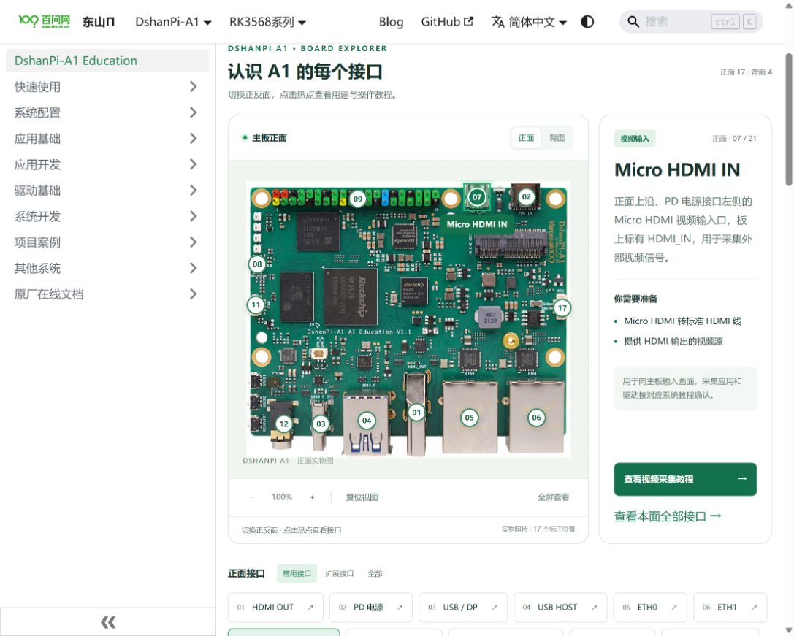
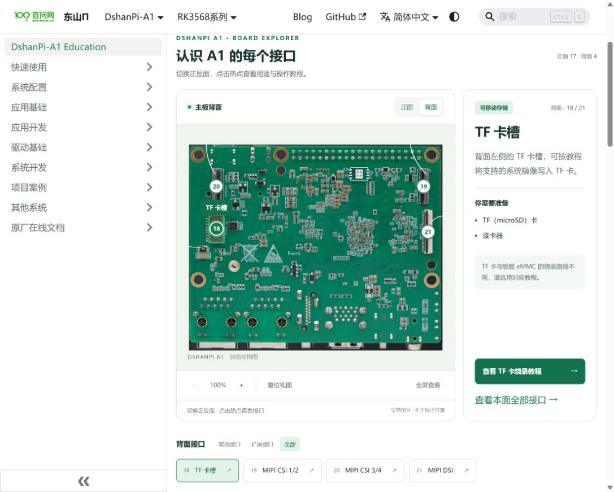

# A1 与 CM5 主板交互设计与修改说明

更新日期：2026 年 11 月 13 日。

主板导览采用正反面实物照片、接口热点和教程说明联动。读者可以先找到接口，再了解用途与准备物品，最后进入对应教程。当前方案已接入 Docusaurus，使用 React、MDX 与 CSS Modules 实现。

## 设计决策

用户确认只需要正反面交互后，最终方案采用两张照片切换。此前的 Three.js 概念探索已结束，当前页面不依赖 Three.js、WebGL 或三维模型。照片与标注分别管理，原始图片保持完整。

视觉延续文档站的绿色主题，使用浅色背景、绿色选中轮廓、圆形数字热点和白色说明面板。名称在悬停、键盘聚焦或选中时出现，减少主板图上的文字遮挡。数字是接口索引，不是 GPIO 针脚编号。

## 页面与覆盖范围

| 页面 | 地址 | 当前内容 |
| --- | --- | --- |
| A1 产品介绍 | [本地预览](http://127.0.0.1:3576/docs/DshanPi-A1/intro) | 直接嵌入交互导览；正面 17 处、背面 4 处标注 |
| CM5 文档导览 | [本地预览](http://127.0.0.1:3576/docs/DshanPi-A1_CM5/QuickStart/BoardExplorer) | 正面 10 处、背面 3 处标注 |
| CM5 宽屏导览 | [本地预览](http://127.0.0.1:3576/cm5/explorer) | 同一组件的宽屏展示，包含认识主板、连接与刷机、日常使用三个场景 |

A1 使用自己的照片、接口数据与教程链接。CM5 使用 Base ver1.2 底板照片及其独立数据。两者共用 `BoardExplorer/` 中的照片查看器、选择状态、接口说明、索引和样式；A1 通过通用入口接入，CM5 保留自己的场景包装。复用方法见 [UI 标准](../standards/site-ui/README.md)。

## 布局与交互规则

| 区域或动作 | 已实现行为 |
| --- | --- |
| 页面布局 | 宽屏并排展示主板与接口说明；窄屏上下排列。A1 隐藏右侧文章目录，为导览腾出空间 |
| 正反面切换 | 切换图片、热点和说明；正面默认选中 HDMI，背面默认选中 TF 卡槽 |
| 默认可见范围 | A1 正面显示 12 个常用热点；CM5 正面显示 8 个常用热点；两块板的背面均显示全部标注 |
| 接口选择 | 点击热点或下方接口名称，同步更新轮廓、名称、用途、准备物品、注意事项和教程入口 |
| 分类筛选 | 常用接口、扩展接口、全部；筛选时选中本面该分类的第一个接口 |
| 缩放和平移 | 100% 至 250%，每次调整 25%；放大后拖动；复位恢复完整视图 |
| 选择新接口 | 清除原来的缩放与平移，使新目标回到完整照片中 |
| 标签避让 | 左右边缘标签向内对齐；上沿标签显示在热点下方 |
| 全屏 | A1 导览和 CM5 宽屏页提供全屏入口；CM5 文档嵌入版隐藏此按钮 |
| 深链接 | 点击接口更新 `?port=接口ID`；加载有效参数时定位对应面和接口，并展开全部接口 |
| 键盘与反馈 | 热点和索引可聚焦、用 Enter 选择；选中状态使用 `aria-pressed`，说明变化通过 `aria-live` 提示 |
| 图片异常 | 显示加载失败提示，接口索引和文字说明仍可使用 |

CM5 的“连接与刷机”用于定位供电、连接口和下载相关按键；“日常使用”提供显示、网络、USB 和 TF 卡入口。实际刷机步骤通过教程链接提供，页面没有设备检测或烧录功能。

## A1 最近一轮调整

用户圈出的四处原本已存在于数据中，但属于扩展接口，因此在默认视图中被隐藏。此次调整将它们纳入常用接口，并细化名称与位置描述，正面默认可见数量从 8 个变为 12 个，总标注数量仍为 17 个。

| 编号 | 显示名称 | 对应位置 |
| --- | --- | --- |
| 07 | Micro HDMI IN | 上沿，PD 电源接口左侧 |
| 09 | 40Pin GPIO 排针 | 上沿左侧的双排彩色排针 |
| 11 | 风扇接口 | 左侧中部，FAN 白色插座 |
| 17 | RTC 电池接口 | 右侧中部，RTC 白色电池插座 |

正面其他默认热点为 HDMI OUT、PD 电源、USB / DP、USB HOST、ETH0、ETH1、MASKROM 和 3.5mm 音频。扩展分类包含 M.2 Key-E、eMMC、RECOVERY、K1 和 K2。背面包含 TF 卡槽、MIPI CSI 1/2、MIPI CSI 3/4 和 MIPI DSI。

## 修改文件与职责

以下路径均相对于仓库根目录。

| 文件 | 职责或修改 |
| --- | --- |
| [A1 介绍页](../docs/DshanPi-A1/intro.mdx) | 插入导览，保留原规格和系统支持内容，将原图放入折叠区域 |
| [A1 接入](../src/components/A1BoardExplorer/index.jsx) | 向公共组件传入板型数据与说明 |
| [通用主板组件](../src/components/BoardExplorer/index.jsx) | 产品页布局，组合共用查看器、接口说明、索引与选择状态 |
| [A1 接口数据](../src/components/A1BoardExplorer/board-data.js) | 图片裁切、热点坐标、名称、文案及教程地址 |
| [共用照片查看器](../src/components/BoardExplorer/PhotoViewer.jsx) | 图片、热点、高亮、标签避让、缩放、拖动、全屏与异常提示 |
| [共用样式](../src/components/BoardExplorer/styles.module.css) | 页面布局、主题色、响应式与暗色主题样式 |
| [CM5 状态与布局](../src/components/CM5BoardExplorer/index.jsx) | 三种阅读场景、步骤与接口联动 |
| [CM5 接口数据](../src/components/CM5BoardExplorer/board-data.js) | CM5 照片、接口及任务入口数据 |
| [CM5 宽屏入口](../src/pages/cm5/explorer.jsx) | 独立页面与站点 Layout |
| [CM5 文档入口](../docs/DshanPi-A1_CM5/1-QuickStart/00-BoardExplorer.mdx) | MDX 内嵌导览 |
| [CM5 使用指南](../docs/DshanPi-A1_CM5/intro.mdx) | 增加两种导览入口；该文件还包含此前教程整理的其他改动 |
| [A1 硬件连接指南](../docs/DshanPi-A1/1-QuickStart/02-HardwareConnectionGuide.md) | 将 M.2 Key-E 插槽位置由“背面”修正为“正面右上方” |

## 图片与数据维护

A1 正面使用 `docs/DshanPi-A1/images/10005.jpg` 的主板区域，背面使用 `10002.jpg`。CM5 照片位于 `static/img/cm5-explorer/`。每面在 `VIEWS` 中维护原图宽度、裁切区域与默认接口。

每个接口在 `PORTS` 中维护稳定的 `id`、编号、名称、正反面、分类、区域 `rect`、说明与教程地址。`rect` 的格式为 `[x, y, width, height]`，使用原图像素坐标。查看器根据裁切范围换算成百分比，使热点跟随照片缩放。

新增或修改接口时，先更新对应板型的数据，再检查默认视图、分类视图、深链接和教程地址。换照片时需要重新核对原图尺寸、裁切与坐标。只有改变交互行为或排版时才需要修改共用查看器与样式。

## 验证结果与边界

最近一次完整检查 `npm run check` 通过，包含行为测试、中英文生产构建和输出资源校验。已有检查覆盖 A1 正反面切换、热点与说明联动、教程目标、键盘选择、缩放、拖动和复位；手机视口检查未出现横向溢出。最新四处热点逐一点击通过，浮动标签均位于展示区域内。CM5 已检查正反面与背面 PCIe0 深链接。

原有 A1 `Desktops` 文档的 3 个失效锚点已修正。网页构建通过不代表板端硬件验证通过。接口电气规格、兼容性和具体烧录顺序仍由对应硬件资料与实板验证确定。

当前版本未实现三维旋转、逐针 GPIO 交互或接线动画；早期概念图中的这些方向不属于现有功能。发布结果以仓库 [自动发布工作流](https://github.com/dshanpi/Docs/actions/workflows/deploy.yml) 的运行记录为准。
