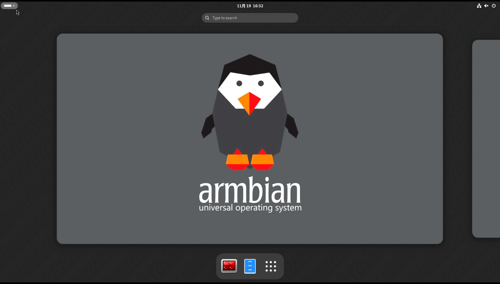
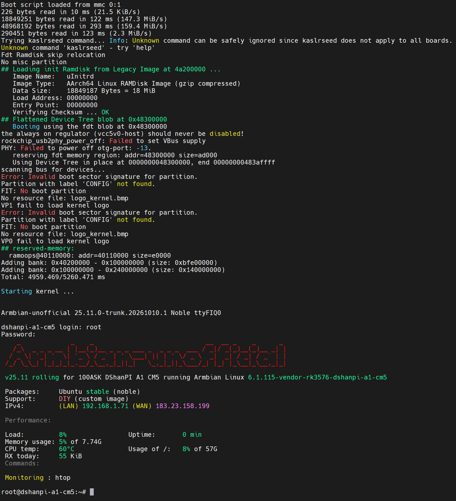
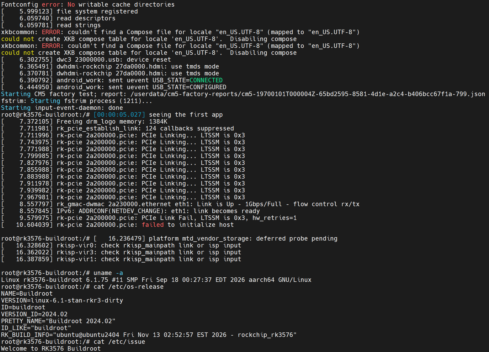
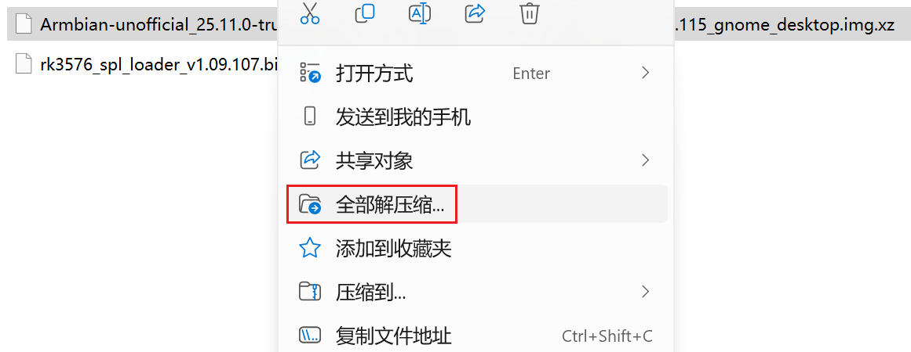

import FirmwareTable, {FirmwareName} from '@site/src/components/CM5FirmwareTable';
import Tabs from '@theme/Tabs';
import TabItem from '@theme/TabItem';

# 选择系统与下载镜像

## 1. 按用途选择系统

需要图形桌面，选 **Armbian GNOME**；通过终端或 SSH 部署服务，选 **Armbian CLI**；为专用设备定制固件，选 **Buildroot**。切换标签可查看对应的实机启动截图。

<Tabs>
<TabItem value="gnome" label="Armbian GNOME 桌面版" default>

连接显示器、键盘和鼠标，在 GNOME 桌面中运行图形应用。图中是桌面的活动概览，底部可打开文件管理器和应用列表。[下载 GNOME 桌面版](#armbian)

</TabItem>
<TabItem value="cli" label="Armbian CLI 命令行版">

通过串口或 SSH 登录，在命令行中安装软件、管理服务。图中已登录，最下方的 `root@dshanpi-a1-cm5:~#` 表示可以输入命令。[下载 CLI 命令行版](#armbian-cli)

</TabItem>
<TabItem value="buildroot" label="Buildroot 系统">

使用 SDK 选择应用和驱动，为专用设备构建固件。图中在终端执行 `cat /etc/os-release`，输出的 `NAME=Buildroot` 可用于确认系统。[下载 Buildroot 固件](#buildroot)

</TabItem>
</Tabs>

## 2. 下载所选镜像

百度网盘提取码：`jevb`。

<FirmwareTable>

| 系统镜像 / 引导文件 | 下载方式 |
| --- | --- |
| <FirmwareName id="armbian">Armbian GNOME 桌面版</FirmwareName> | **下载方式 1：** [GitHub 直链](https://github.com/dshanpi/ArmBianOS/releases/download/dshanpi-a1-cm5-2026.10.10-1/Armbian-unofficial_25.11.0-trunk.20261010.1_Dshanpi-a1-cm5_noble_vendor_6.1.115_gnome_desktop.img.xz) **下载方式 2：** [百度网盘](https://pan.baidu.com/s/1Xo342SQDyKZb5xRiNAD-Dw?pwd=jevb) → `115_DshanPI-A1-CM5资料/03_系统固件/01_Armbian发行版系统(基于Ubuntu24.04)/`，选以 `_gnome_desktop.img.xz` 结尾的文件 |
| <FirmwareName id="armbian-cli">Armbian CLI 命令行版</FirmwareName> | **下载方式 1：** [GitHub 直链](https://github.com/dshanpi/ArmBianOS/releases/download/dshanpi-a1-cm5-2026.10.10-1/Armbian-unofficial_25.11.0-trunk.20261010.1_Dshanpi-a1-cm5_noble_vendor_6.1.115.img.xz) **下载方式 2：** [百度网盘](https://pan.baidu.com/s/1Xo342SQDyKZb5xRiNAD-Dw?pwd=jevb) → `115_DshanPI-A1-CM5资料/03_系统固件/01_Armbian发行版系统(基于Ubuntu24.04)/`，选以 `6.1.115.img.xz` 结尾的文件 |
| <FirmwareName id="buildroot">Buildroot 系统</FirmwareName> | **下载方式 1：** [百度网盘](https://pan.baidu.com/s/1Xo342SQDyKZb5xRiNAD-Dw?pwd=jevb) 进入目录：`115_DshanPI-A1-CM5资料/03_系统固件/02_Buildroot系统/` 下载文件：`DshanPI_A1_CM5-buildroot.zip` |
| <FirmwareName id="cm5-loader">Loader 引导文件（刷机用）</FirmwareName> | **下载方式 1：** [百问网直链](https://dl.100ask.net/Hardware/MPU/RK3576-DshanPi-A1/rk3576_spl_loader_v1.09.107.bin) **下载方式 2：** [百度网盘](https://pan.baidu.com/s/1Xo342SQDyKZb5xRiNAD-Dw?pwd=jevb) 进入目录：`115_DshanPI-A1-CM5资料/03_系统固件/00_loder引导文件/` 下载文件：`rk3576_spl_loader_v1.09.107.bin` |

</FirmwareTable>

Armbian 镜像校验文件：[SHA256SUMS](https://github.com/dshanpi/ArmBianOS/releases/download/dshanpi-a1-cm5-2026.10.10-1/SHA256SUMS)。

## 3. 解压并准备刷写

在 Windows 中，右键单击镜像压缩包，选择 **「全部解压缩…」**。Armbian 镜像请先按 `SHA256SUMS` 校验；若右键菜单没有解压选项，可用 7-Zip。

| 系统 | 压缩包 | 解压结果 |
| --- | --- | --- |
| Armbian 桌面版 / CLI 版 | `.img.xz` | 去掉 `.xz` 后的同名 `.img` |
| Buildroot | `DshanPI_A1_CM5-buildroot.zip` | `RK3576-CM5-buildroot.img` |

Loader 引导文件（`.bin`）无需解压。

下一步：[向 eMMC 烧录系统](02-FlashEMMC.md)。
