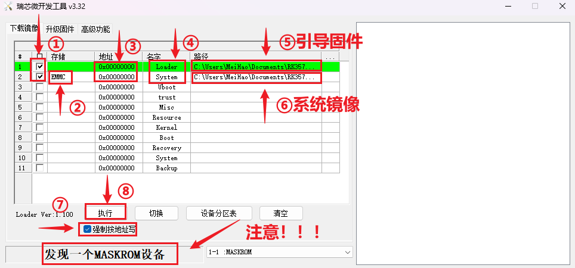
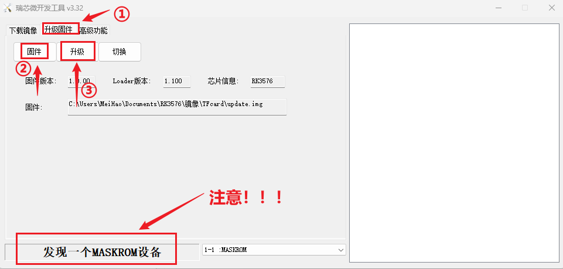
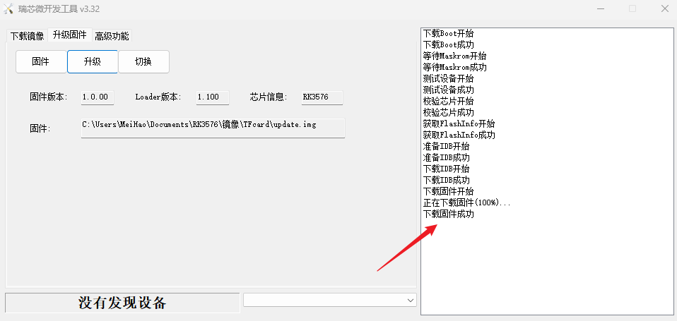

import ArmbianFlashControls from './_ArmbianFlashControls.mdx';
import EraseEmmcControls from './_EraseEmmcControls.mdx';
import MaskromSteps from './_MaskromSteps.mdx';

# 向 eMMC 烧录系统

在 Windows 上使用 RKDevTool 向 DshanPI A1 CM5 V1.2 底板上的 eMMC 写入系统。先完成[驱动安装与烧录接线](#driver-setup)，再按镜像选择：[烧录 Armbian](#flash-armbian) 或 [烧录 Buildroot](#flash-buildroot)。

:::warning 先备份 eMMC 数据
烧录会覆盖 eMMC 上的分区和文件。开始前，先备份需要保留的数据。
:::

## 0. 安装 USB 驱动并进入烧录模式 {#driver-setup}

### 0.1 安装驱动并打开 RKDevTool

**首次使用 RKDevTool：** 分别下载并解压 [USB 驱动 v5.1.1（ZIP）](https://dl.100ask.net/Hardware/MPU/RK3576-DshanPi-A1/DriverAssitant_v5.1.1.zip) 和 [RKDevTool v3.32（ZIP）](https://dl.100ask.net/Hardware/MPU/RK3576-DshanPi-A1/RKDevTool_Release_v3.32.zip)。以管理员身份运行 `DriverInstall.exe`，点击 **驱动安装**，完成后打开 `RKDevTool.exe`。

### 0.2 接线并进入 MASKROM 模式

<MaskromSteps />

进入 MASKROM 模式后，Windows 设备管理器应显示 **Rockusb Device**。若显示未知设备或黄色感叹号，重新安装驱动；若未发现设备，检查 Type-C 下载口，换用数据线或电脑上的另一个 USB 接口，再断电重试。[硬件连接图](HardwareConnections.md) · [刷机故障排查](../3-Maintenance/02-Troubleshooting.md)

MASKROM 松键时机、烧录后的自动重启行为，以及下列两种写入流程仍待 DshanPI A1 CM5 实板验证。

## 1. 烧录 Armbian（桌面版 / CLI 版） {#flash-armbian}

[下载并校验 DshanPI A1 CM5 镜像和 Loader](01-Resources.md#armbian-files)，将 `.img.xz` 解压为 `.img`。如使用 HDMI 显示器做首次初始化，请在点击 **执行** 前接好显示器和 USB 键盘。

打开 RKDevTool 的 **下载镜像** 页，对照图中编号操作。

**①～④ 设置写入位置。** 只勾选前两行，将第二行的存储设为 **EMMC**。两行地址均填 `0x00000000`，名称依次为 **Loader** 和 **System**。

**⑤～⑥ 选择文件。** 点击每行最右侧的方格，分别选择下表中的引导文件和系统镜像。

<ArmbianFlashControls />

**⑦～⑧ 开始烧录。** 勾选 **强制按地址写**，确认左下角显示 **发现一个 MASKROM 设备**，再点 **执行**。保持 12V 供电和 USB 连接，直到右侧日志显示 **下载完成** 且无报错。

若烧录成功后未自动启动，确认 TF 卡已取出、MASKROM 键已松开。拔下 USB 线和电源，再仅接回 12V 电源。

:::tip 下一步
烧录完成后，点击 **[开始首次启动与登录](03-FirstBoot.md)**，按提示登录 Armbian、设置密码并确认系统从 eMMC 启动。
:::

## 2. 烧录 Buildroot {#flash-buildroot}

### 2.1 准备固件

[下载 Buildroot 固件](01-Resources.md#buildroot)，解压 `DshanPI_A1_CM5-buildroot.zip`，得到 `RK3576-CM5-buildroot.img`。这个打包固件无需单独加载 Loader。

### 2.2 在「升级固件」页写入 eMMC

1. 打开 **升级固件** 页，点击 **固件**，选择 `RK3576-CM5-buildroot.img`。
2. 确认固件已加载，底部显示 **MASKROM**，点击 **升级**。

   图中①～③标出按钮位置。给 DshanPI A1 CM5 烧录时，在②选择上一步解压的 `RK3576-CM5-buildroot.img`。

   

3. 保持 12V 供电和 USB 连接，等待右侧日志显示 **下载固件成功**。

   

### 2.3 启动 Buildroot

保持 TF 卡已取出、MASKROM 键已松开。若烧录成功后未自动启动，断开 USB 和 12V 电源，再仅接回 12V 电源。通过[调试串口](HardwareConnections.md#7-通过-40-针排针访问调试串口)查看启动日志。进入命令行后，运行 `cat /etc/os-release`，确认输出包含 `NAME=Buildroot`。

## FAQ {#faq}

### 烧录失败，如何擦除 eMMC 后重试？ {#erase-emmc}

如果 eMMC 之前装过 Armbian 或其他 Linux 系统，旧的分区或引导数据可能影响新系统启动。遇到烧录失败或重刷后无法启动时，可以先擦除 eMMC，再重新烧录。

:::warning 先备份数据
**擦除所有**会清空 eMMC 上的系统、分区和用户文件。请先备份需要保留的数据，擦除期间保持 12 V 供电和 USB 连接。
:::

1. **进入高级功能。** 按[第 0 节](#driver-setup)让开发板进入烧录模式。确认 RKDevTool 底部显示 **发现一个 MASKROM 设备**，点击顶部的 **高级功能**。
2. **选择 Loader。** 点击 **Boot** 行右侧的 **…**，选择 [rk3576_spl_loader_v1.09.107.bin](https://dl.100ask.net/Hardware/MPU/RK3576-DshanPi-A1/rk3576_spl_loader_v1.09.107.bin)。
3. **下载 Loader。** 点击同一行的 **下载**，等待右侧日志提示下载成功。
4. **确认存储。** 点击 **获取当前存储**，确认当前存储为 **EMMC** 后再继续。
5. **擦除 eMMC。** 点击 **擦除所有**，等待右侧日志提示擦除成功。

<EraseEmmcControls />

擦除成功后，重新进入 MASKROM 模式，按所用镜像继续[烧录 Armbian](#flash-armbian) 或[烧录 Buildroot](#flash-buildroot)。
