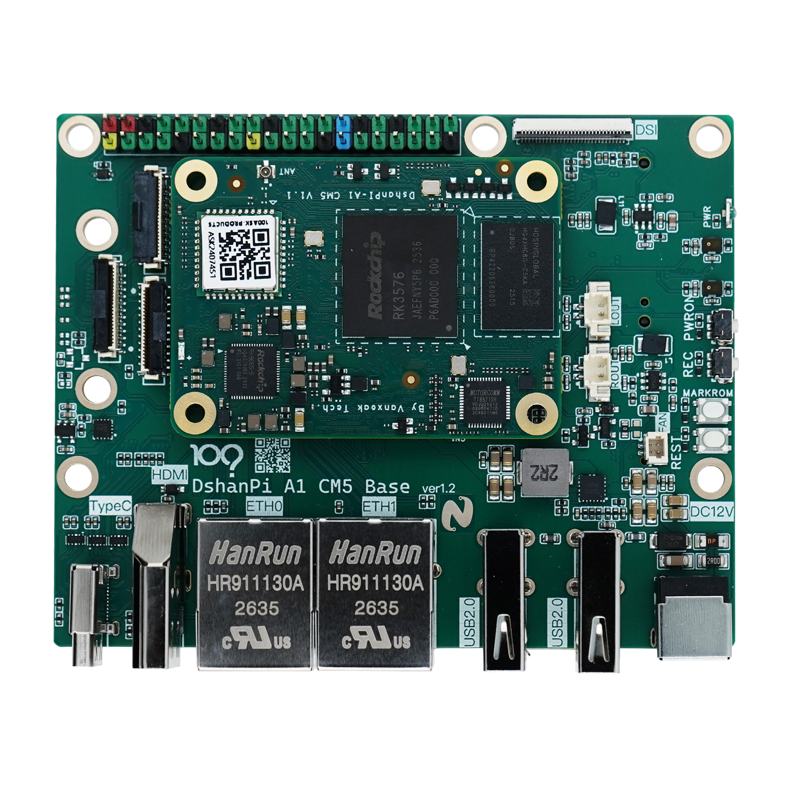

# 向 eMMC 烧录系统

在 Windows 上使用 RKDevTool，将 DshanPI A1 CM5 的 Armbian 整盘镜像写入核心板 eMMC。以下接线适用于官方 **V1.2 底板**。

:::warning 先备份 eMMC 数据
整盘写入会覆盖 eMMC 上的分区和文件。开始操作前，先将需要保留的数据备份到其他设备。
:::

## 1. 准备镜像和刷机工具

1. 在 Windows 电脑上下载 CM5 的 GNOME 或 CLI 镜像（`.img.xz`）及同一版本的 `SHA256SUMS`。确认文件名含 `Dshanpi-a1-cm5`，按发布页校验压缩包。校验一致后解压，得到烧录用的 **`.img`** 文件。[镜像下载与校验](01-Resources.md)
2. 下载 **DriverAssitant v5.1.1**、**RKDevTool v3.32** 和 **`rk3576_spl_loader_v1.09.107.bin`**。解压驱动和工具压缩包，按下载页的 SHA-256 校验 Loader 文件。[Windows 刷机资料](Downloads.md#flash-tools)
3. 首次使用时，在驱动目录中以管理员身份运行 `DriverInstall.exe`，点击 **驱动安装**。安装完成后打开工具目录中的 `RKDevTool.exe`。
4. 准备底板配套的 **12V 直流电源**和一根支持数据传输的 **USB Type-C 线**。使用其他适配器时，先核对输出电压、额定电流、插头尺寸和极性。

如果手里的是为 CM5 构建的 Buildroot 打包固件 `update.img`，请在 RKDevTool 的 **升级固件** 页加载。本页的 **下载镜像** 配置用于 Armbian 整盘镜像。[Buildroot 固件说明](../4-Development/01-BuildrootSDK.md)

## 2. 接线并进入 MASKROM 下载模式

底板正面朝上，将双网口朝向自己。左端 HDMI 旁的 **USB1（Type-C）** 接电脑，右端的 **DC1（DC12V）** 接电源。**SW5（MASKROM）** 在底板右边缘，紧挨 RESET 键上方。[定位 USB1](/cm5/explorer?port=typec) · [定位 DC1](/cm5/explorer?port=power) · [定位 SW5](/cm5/explorer?port=maskrom)



1. 在底板断电时确认核心板已装好，取出 TF 卡，拔下 USB 存储设备。
2. 保持 **DC1 断电**，用 Type-C 数据线将电脑连接到 **USB1**。
3. **按住 SW5，再将 12V 电源接入 DC1**。上电后松开 SW5。A1 参考教程在上电约 2～3 秒后松键，**CM5 的松键时机待实板确认**。
4. 查看 RKDevTool 窗口底部。显示 **发现一个 MASKROM 设备** 后，继续配置镜像。

如果显示 **没有发现设备**，检查数据线是否接在 USB1，并在 Windows 设备管理器中检查 Rockusb 驱动。如果显示 **LOADER** 或开发板正常启动，先停止烧录。若系统已启动，请正常关机。断开电源和数据线，确认按键为 SW5，再按上述顺序重试。

供电、下载口和按键分别见底板原理图第 6、3、11 页。其他底板版本请按相应图纸核对位置。[V1.2 底板原理图](https://dl.100ask.net/Hardware/MPU/RK3576-DshanPi-A1-CM5/SCH_DshanPI-A1-CM5-Base.pdf) · [底板位号图第 1 页](https://dl.100ask.net/Hardware/MPU/RK3576-DshanPi-A1-CM5/RDM_DshanPI-A1-CM5-Base.pdf#page=1)

## 3. 写入并校验镜像

在 RKDevTool 打开 **下载镜像** 页，只勾选前两行 **Loader** 和 **System**。在 **System** 行的 **存储** 列选择 **EMMC**，点击各行最右侧的单元格选择文件。

| 勾选行 | 地址 | 选择的文件 |
| --- | --- | --- |
| Loader | `0x00000000` | `rk3576_spl_loader_v1.09.107.bin` |
| System | `0x00000000` | 已解压的 CM5 Armbian 整盘镜像（`.img`） |


图为 A1 教程中的工具界面，用于定位控件。请在本机选择第 1 节准备的 CM5 文件。**此 Loader 和写入配置在 CM5 上的完整烧录流程待实板验证。**

1. 勾选 **强制按地址写**。确认目标为 **EMMC**、System 行选中 CM5 的 `.img`、窗口底部仍显示 **MASKROM**，再点击 **执行**。
2. 保持 12V 供电和 USB 数据线连接。右侧日志会依次显示 Loader 下载（`Download Boot`）、镜像写入（`Download Image`）和校验（`Check Image`）。**等校验成功、任务结束后，再进行启动检查。**

若 Loader 下载失败，先核对 Loader 文件和 USB 连接。若写入或校验失败，保留右侧完整日志，检查供电、数据线和镜像校验值。[刷机故障排查](../3-Maintenance/02-Troubleshooting.md)

## 4. 确认系统从 eMMC 启动

保持 TF 卡取出、SW5 松开。校验成功后，观察开发板是否进入 Armbian。**烧录后是否自动重启待 CM5 实板确认。** 若任务已结束，且确认系统尚未启动，断开 DC1 和 USB1，再仅接回 12V 电源开机。

登录 Armbian 后，在**开发板终端**执行以下命令。

```bash
findmnt -n -o SOURCE /
lsblk -o NAME,SIZE,TYPE,MOUNTPOINTS
```

第一条命令显示根文件系统所在设备。用第二条命令找到该分区所属的整盘，再按首次启动教程核对其设备类型为 `MMC`。**根分区位于 eMMC，并能在正常关机后从 eMMC 冷启动**，即可确认烧录结果。设备编号以板端输出为准。[首次登录与启动介质检查](03-FirstBoot.md#确认根文件系统位于-emmc)
