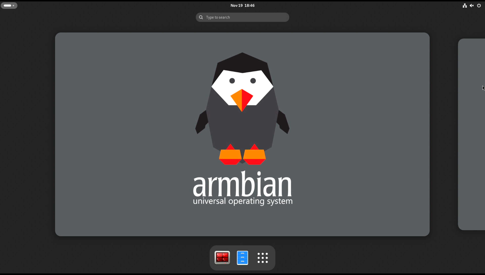

import CM5PromptImage from '@site/src/components/CM5PromptImage';
import CM5ClickTarget from '@site/src/components/CM5ClickTarget';

# 首次启动与登录

适用镜像：Armbian GNOME 桌面版、CLI 命令行版（2026.10.10-1）。

**第一次使用 DshanPI A1 CM5？** 从[接线准备](#first-boot-prepare)开始，跟着屏幕提示逐步操作。熟悉 Armbian 的读者可直接按下表完成初始化。

## 首次启动速查 {#quick-start}

| 步骤 | 操作要点 |
| --- | --- |
| [接线](#first-boot-prepare) | 烧录前接好 HDMI、USB 键盘；使用 Wi-Fi 时，上电前装好天线。烧录完成后保持 12V 供电。 |
| [管理员与 Shell](#设置-root-密码选择命令行) | 输入两次新 root 密码，选 `1) bash`。若先出现 `login:`，用 `root` / `1234` 登录。 |
| [普通账号](#创建日常登录账号) | 输入登录名 → 两次输入账号密码 → 填显示名称。 |
| [联网](#first-boot-wifi) | 已接网线可跳过；无线配网输入 `y` → 选网络序号 → 输入 Wi-Fi 密码。 |
| [时区与语言](#first-boot-locale) | 核对时区。需要简体中文时输入 `y`，再选 `zh_CN.UTF-8`。 |
| [登录](#2-登录系统) · [检查 eMMC](#确认根文件系统位于-emmc) | 用普通账号登录；运行 `findmnt -n -o SOURCE /`，核对根分区所属磁盘的类型为 `MMC`。 |

## 接线准备 {#first-boot-prepare}

:::tip 首次启动前接好显示器
如需使用板载 Wi-Fi，请在上电前装好核心板天线。烧录前接好 **HDMI 显示器和 USB 键盘**，选择对应的 HDMI 输入源。烧录完成后保持 12V 供电，等待开发板重启。[查看接线图](HardwareConnections.md#4-连接-hdmi-显示器)
:::

## 1. 完成首次设置

开发板重启后，在 HDMI 屏幕上按以下顺序操作。每次输入后按 **Enter** 确认。每张小图只显示当前操作。需要核对整个过程时，可查看[本节末尾的完整截图](#first-setup-overview)。

### 设置 root 密码，选择命令行

1. **设置并确认 root 密码。** 在 `Create root password` 后输入新密码；出现 `Repeat root password` 时再输一次。若先看到 `login:`，用 `root` 和初始密码 `1234` 登录后再设置。

   <CM5PromptImage src={require('./first-boot/prompts/root.png').default} width={327} alt="连续两行提示分别要求设置、确认 root 密码" />

2. **选择 Bash。** 在命令行选项中输入 `1`。显示 `Shell: BASH` 后，继续创建普通账号。

   <CM5PromptImage src={require('./first-boot/prompts/shell.png').default} width={445} alt="选择 1 对应 bash，随后显示 Shell: BASH" />

### 创建日常登录账号

1. **设置登录名和密码。** 在 `username` 后输入自定义登录名（图中为 `baiwen`），再按提示输入两次该账号的密码。桌面版需完成此步才能启用桌面。

   <CM5PromptImage src={require('./first-boot/prompts/user.png').default} width={600} alt="三行依次为登录名、普通用户密码、重复密码" />

2. **填写显示名称。** 在 `real name` 后输入显示名称（如 `Baiwen`）。看到 `account baiwen has been created` 表示创建成功，日常登录仍用 `baiwen`。

   <CM5PromptImage src={require('./first-boot/prompts/name.png').default} width={690} alt="填写显示名称 Baiwen 后，向导确认登录账号 baiwen 已创建" />

### 未接网线时，连接板载 Wi-Fi {#first-boot-wifi}

已通过网线上网，可直接跳到[时区和语言设置](#first-boot-locale)。使用 Wi-Fi 时，创建账号后按以下提示操作：

1. **启用 Wi-Fi。** 看到 `Connect via wireless? [Y/n]`，输入 `y` 并按回车。
2. **选择网络。** 在列表中找到自己的 Wi-Fi 名称，输入左侧序号并按回车。图中 `Programmers7` 对应 `9`；以当前扫描结果为准。

   

3. **输入密码。** 看到 `Enter a password for …`，输入该 Wi-Fi 的密码并按回车。
4. **等待连接。** 出现 `Probing wireless link` 或 `Probing internet connection` 时请等待。向导进入时区或语言设置后，按下一节继续，后续步骤与有线联网相同。

   


<details>
<summary>查看其他截图：启用 Wi-Fi、输入密码、等待连接</summary>


</details>

### 确认时区，选择中文 {#first-boot-locale}

1. **核对时区。** 图中已识别为 `Asia/Shanghai`；若未识别，按提示手动选择。看到 `Set user language based on your location?` 时输入 `y`，继续选择语言。

   <CM5PromptImage src={require('./first-boot/prompts/zone.png').default} width={545} alt="自动检测到上海时区，在语言设置提示后输入 y" />

2. **选择简体中文。** 输入 `zh_CN.UTF-8` 对应的编号（图中为 `5`）。桌面版随后生成语言环境，显示 `Now starting desktop environment...` 时等待桌面启动即可。

   <CM5PromptImage src={require('./first-boot/prompts/language.png').default} width={750} alt="语言选项中的 5 对应 zh_CN.UTF-8，在选择提示后输入 5" />

### 完整步骤对照 {#first-setup-overview}

下图是 **GNOME 桌面版已联网**时的完整初始化实录，从设置 root 密码到启动桌面。点击图片可查看原图。

<a href={require('./first-boot/starting-desktop.png').default} aria-label="查看首次初始化完整截图原图">
  
</a>

## 2. 登录系统

**GNOME 桌面版：** 看到 `Now starting desktop environment...` 后，保持供电，等待桌面出现。若出现登录界面，选择刚创建的普通账号并输入密码。** 同时连接 HDMI 和 MIPI LCD 时，默认主屏是 MIPI LCD。**



<details>
<summary>查看 MIPI LCD 实拍</summary>

<svg viewBox="0 0 1707 1280" width="480" role="img" aria-label="底板通过 DSI 排线连接 MIPI LCD，屏幕显示 Armbian 桌面" style={{display: 'block', maxWidth: '100%', height: 'auto', margin: '0 auto 1rem'}}>
  <image href={require('./first-boot/mipi-lcd.jpg').default} width="1280" height="1707" transform="translate(0 1280) rotate(-90)" />
</svg>

</details>

**CLI 命令行版：** 使用普通账号登录终端，输入 `whoami`。若显示刚创建的用户名（如 `baiwen`），说明已用该账号登录。

## 3. 确认从 eMMC 启动 {#确认根文件系统位于-emmc}

在 DshanPI A1 CM5 上，**桌面版**按 **Super**（Windows 徽标键），搜索 `terminal` 并回车打开终端。**命令行版**用普通账号登录即可。

1. **查看根分区。** 记下输出的分区名，图中为 `/dev/mmcblk0p1`。

   ```bash
   findmnt -n -o SOURCE /
   ```

2. **找到所属磁盘。** 在列表中找到该分区，沿缩进向上看一层，图中为 `mmcblk0`。

   ```bash
   lsblk -o NAME,TYPE,MOUNTPOINTS
   ```

3. **判断存储类型。** 找到该磁盘对应的输出行，行末为 `MMC` 表示 **eMMC**，为 `SD` 表示 **TF 卡**。

   ```bash
   grep -H . /sys/class/block/mmcblk[0-9]/device/type
   ```

**实测示例**

<a href={require('./first-boot/emmc-check.png').default} aria-label="查看 eMMC 检查结果原图">
  
</a>

图中最后一行显示 `mmcblk0/device/type:MMC`，根文件系统位于 **eMMC**。

## 4. 设置桌面显示输出 {#display-output}

用 HDMI 线将底板的 HDMI 输出接到显示器，在 **GNOME 桌面**空白处右键，选择 **Display Settings**（显示设置）。如需调整分辨率或刷新率，选择显示器支持的模式。[查看显示器接线](HardwareConnections.md#4-连接-hdmi-显示器)

<CM5ClickTarget src={require('./first-boot/display-menu.png').default} width={220} viewBox="0 0 405 273" target={[23, 119, 364, 70]} alt="在桌面右键菜单中点击 Display Settings" />

### 双屏使用：将 HDMI 设为主屏

1. 在 **Join**（扩展）模式下，① 展开 **Primary Display**（主显示器）菜单，② 选择 HDMI 显示器。图中屏幕 1 是默认的 MIPI 屏，屏幕 2（**HJW 27″**）是 HDMI 显示器。

   <CM5ClickTarget src={require('./first-boot/display-primary.png').default} width={570} viewBox="0 425 1118 304" targets={[[721, 457, 275, 58], [830, 605, 283, 70]]} alt="① 展开主显示器菜单，② 选择 HDMI 显示器 HJW 27″" />

2. 点击右上角的 **Apply**。确认 HDMI 屏上出现桌面顶栏后，在倒计时结束前点击 **Keep Changes**。此时 HDMI 是主屏，MIPI 仍可作为扩展屏。

   <CM5ClickTarget src={require('./first-boot/display-primary-apply.png').default} width={360} viewBox="1500 0 620 106" target={[1968, 4, 148, 68]} alt="点击设置窗口右上角的 Apply" />

   <CM5ClickTarget src={require('./first-boot/display-primary-keep.png').default} width={310} viewBox="0 0 616 282" target={[306, 217, 306, 61]} alt="在确认框中点击 Keep Changes 保存主屏设置" />

### 只用 HDMI：关闭 MIPI 输出

1. 如果只接了 HDMI 屏，而显示设置中仍列有 **Built-in display**，点击显示器列表中的这一行，打开 MIPI 屏的详细设置。

   <CM5ClickTarget src={require('./first-boot/display-builtin.png').default} width={570} viewBox="0 447 1086 326" target={[30, 565, 998, 92]} alt="点击显示器列表中的 1 Built-in display 行，进入 MIPI 屏设置" />

2. ① 关闭 **Built-in display** 开关。确认开关变灰后，② 点击右上角的 **Apply**。

   <CM5ClickTarget src={require('./first-boot/display-builtin-on.png').default} width={540} viewBox="55 105 1080 120" target={[998, 135, 101, 63]} alt="点击 Built-in display 行右侧的蓝色开关，将其关闭" />

   <CM5ClickTarget src={require('./first-boot/display-builtin-off.png').default} width={680} viewBox="883 0 1123 235" targets={[[937, 137, 100, 61], [1863, 4, 138, 67]]} alt="① 确认内置屏开关已变灰，② 点击 Apply" />

3. 确认 HDMI 屏正常显示桌面，在倒计时结束前点击 **Keep Changes**。保存后，桌面仅输出到 HDMI 屏。

   <CM5ClickTarget src={require('./first-boot/display-hdmi-keep.png').default} width={310} viewBox="0 0 615 293" target={[305, 222, 306, 66]} alt="点击 Keep Changes 保存仅使用 HDMI 的设置" />

如需让声音也从 HDMI 显示器输出，在声音设置中选择该显示器并测试左右声道。[音频功能测试](../SystemConfig/04-AudioConfig.md#测试声音输出)

## 5. 设置桌面电源管理 {#power-settings}

需要让 DshanPI A1 CM5 在空闲时保持亮屏并持续运行，可在 **GNOME 桌面版**中按以下步骤设置。

1. **打开设置。** ① 点击桌面右上角的系统状态区，② 点击齿轮图标，打开 **Settings**（设置）。

   <CM5ClickTarget src={require('./first-boot/power-settings.png').default} width={420} viewBox="0 0 762 200" targets={[[575, 3, 180, 50], [145, 96, 76, 78]]} alt="① 展开右上角的系统菜单，② 点击设置齿轮" />

2. **关闭自动熄屏。** ① 在左侧选择 **Power**（电源），② 展开 **Screen Blank** 右侧的时间菜单，③ 选择 **Never**（从不）。

   <CM5ClickTarget src={require('./first-boot/power-screen-blank.png').default} width={720} viewBox="-24 183 1730 812" targets={[[45, 530, 137, 65], [1396, 215, 190, 63], [1453, 898, 209, 67]]} alt="① 选择 Power，② 打开熄屏时间菜单，③ 选择底部的 Never" />

3. **关闭自动挂起。** ① 点击 **Automatic Suspend** 一行右侧的 **On**，② 在弹窗中关闭 **When Idle**（空闲时）开关。关闭弹窗，确认该行显示 **Off**。

   <CM5ClickTarget src={require('./first-boot/power-suspend-on.png').default} width={610} viewBox="0 163 1096 253" targets={[[979, 303, 89, 58], [588, 329, 99, 62]]} alt="① 点击电源页面右侧的 On 打开自动挂起设置，② 点击弹窗中的 When Idle 开关将其关闭" />

   <details>
   <summary>查看关闭后的状态</summary>

   <CM5ClickTarget src={require('./first-boot/power-suspend-off.png').default} width={530} viewBox="3 158 1097 240" target={[964, 282, 105, 72]} alt="When Idle 开关已变灰，电源页面的自动挂起状态显示 Off" />
   </details>

4. **设置电源键行为。** ① 展开 **Power Button Behavior**。如需避免误触，选择图中 ② **Nothing**（无操作）。如需短按电源键关机，选择 **Power Off**（关机）。

   <CM5ClickTarget src={require('./first-boot/power-button.png').default} width={590} viewBox="18 389 1104 344" targets={[[856, 420, 165, 69], [897, 636, 171, 73]]} alt="① 打开电源键行为菜单，② 选择 Nothing，让短按电源键不执行操作" />

[常用系统操作](../SystemConfig/09-CommonOperations.md) · [系统配置与应用](/docs/DshanPi-A1_CM5/category/system-config) · [启动与登录故障排查](../3-Maintenance/02-Troubleshooting.md)

## 常见问题（FAQ） {#faq}

### 开机后还没有创建普通用户，怎么登录？

1. 看到 `login:` 时，输入默认用户名 `root`，按 **Enter**。
2. 看到 `Password:` 时，输入初始密码 `1234`，按 **Enter**。如果已经设置过 root 密码，请输入自己设置的密码。

首次登录后，按屏幕提示设置新的 root 密码，再[创建日常登录账号](#创建日常登录账号)。
