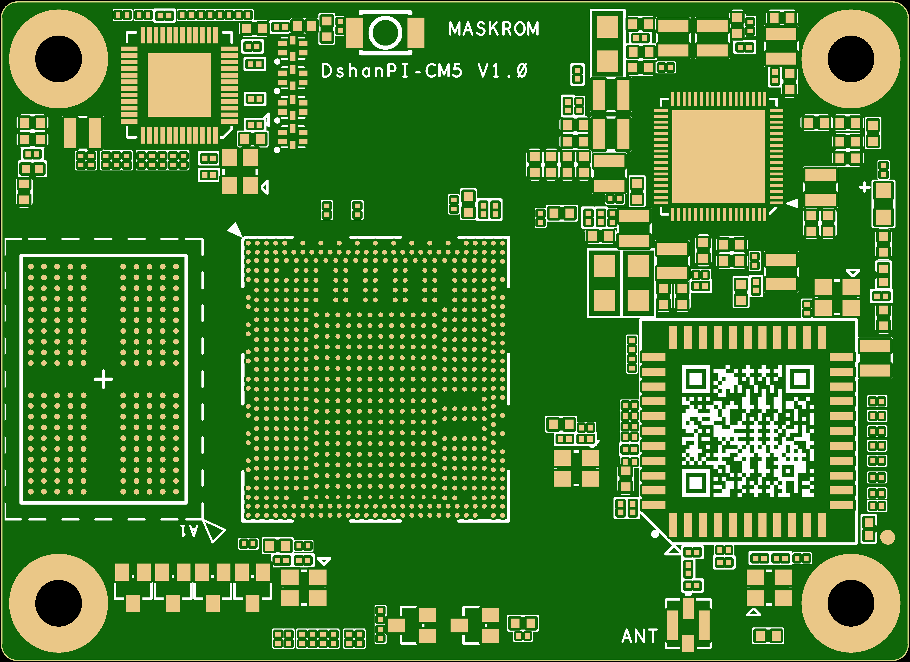

# 硬件资料

先看 DshanPI A1 CM5 核心板和底板各自的版本丝印，再选对应图纸。只需找到电源口、下载口或按键时，可直接打开[交互认识主板](../1-QuickStart/00-BoardExplorer.mdx)。

## 按用途下载图纸

| 要确认什么 | 查看哪份资料 |
| --- | --- |
| 底板接口接到哪条信号线、使用什么电压 | 在[底板原理图](../1-QuickStart/Downloads.md#carrier-board)中搜索接口位号或网络名。 |
| 器件装在底板哪一面、走线经过哪里 | 用[底板位号图和 PCB 工程](../1-QuickStart/Downloads.md#carrier-board)核对位置和走线。 |
| 核心板尺寸、连接器布局或焊盘封装 | 下载[核心板尺寸图、原理图和 Allegro 封装](../1-QuickStart/Downloads.md#core-board)。 |

## 核对硬件版本

2026 年 11 月 17 日核对的底板原理图中，板名为 `A1-CM5-Base-V1.2`，图纸修订栏为 `V1.0`。与实物比对时看**板名和底板丝印**。若位号或布局有差异，先找到匹配修订的图纸，再接线。

交互导览使用 **Base ver1.2** 底板照片。下列两图展示 **V1.0 核心板**，可用于辨认正反面和连接器。[核心板硬件资料与讨论](https://forums.100ask.net/t/topic/10577)

查看核心板正面 PCB 图

查看核心板背面 PCB 图

