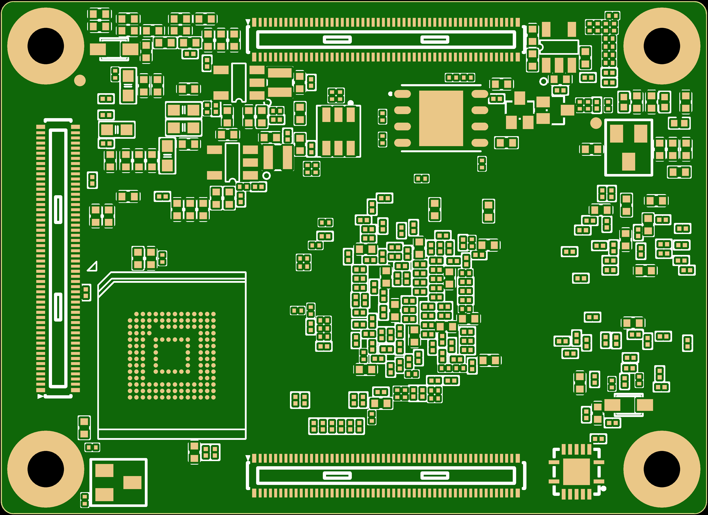

# 硬件资料

DshanPI A1 CM5 由核心板与配套底板组成。核心板与底板分别维护硬件版本，查阅接口、连接外设或修改 PCB 时，先核对实物上的板名与版本丝印。

想先找到接口的位置，可以打开 [交互认识主板](../1-QuickStart/00-BoardExplorer.mdx)，或使用 [宽屏交互视图](/cm5/explorer)。本页集中提供电路、器件位置和 PCB 工程资料。

## 底板资料下载

底板原理图、位号图和开源 PCB 工程见 [资料下载 · 底板](../1-QuickStart/Downloads.md#carrier-board)。

下载 PDF 后可在阅读器中搜索器件位号或网络名称。查找一个接口时，先在原理图中确认电气连接，再用位号图定位实物；需要了解走线和布局时，再查看 PCB 工程。

## 硬件版本说明

以下记录对应 **2026 年 11 月 17 日核对的资料**：

| 对象 | 版本或标识 | 说明 |
| --- | --- | --- |
| 底板原理图中的板名 | `A1-CM5-Base-V1.2` | 原理图图框的“板子”字段；使用前与实物底板丝印核对 |
| 原理图图纸版本栏 | `V1.0` | 与上述底板板名是两个字段，不应据此将底板认定为 V1.0 |
| 底板位号图 | 共 2 页 | 用于定位器件；与原理图、PCB 工程和实物的位号、布局一起核对 |
| 站内交互导览 | Base ver1.2 底板照片 | 便于识别接口位置；详细针脚与电气连接查阅原理图 |
| 下方核心板 PCB 图 | CM5 V1.0 核心板 | 展示核心板外形与连接器布局，版本独立于底板 |

不同修订的底板可能调整器件、针脚或连接方式。保存资料时一并记录下载日期和对应的实物版本；发现位号或布局不一致时，先核对文件修订，再按匹配的资料接线。

## CM5 核心板资料

核心板原理图、尺寸图、Allegro 封装库和位号图见 [资料下载 · 核心板](../1-QuickStart/Downloads.md#core-board)。下面的 CM5 V1.0 核心板 PCB 图可用于辨认外形与连接器位置。硬件问题可在 [CM5 核心板资料帖](https://forums.100ask.net/t/topic/10577) 讨论。

查看核心板正面 PCB 图

查看核心板背面 PCB 图

## 按操作选择下一步

| 你要做什么 | 对应入口 |
| --- | --- |
| 认识底板正反面和接口位置 | [交互认识主板](../1-QuickStart/00-BoardExplorer.mdx) |
| 下载系统镜像与刷机工具 | [选择系统与下载镜像](../1-QuickStart/01-Resources.md) |
| 向 eMMC 安装系统 | [向 eMMC 烧录系统](../1-QuickStart/02-FlashEMMC.md) |
| 查找系统源码及软件版本关系 | [资料与版本关系](01-ResourcesAndVersions.md) |

硬件资料用于确认电路和接口。系统镜像对各外设的支持状态，以及刷机接线、Loader 和按键操作的实测进展，见 [验证状态与后续内容](02-Verification.md)。
