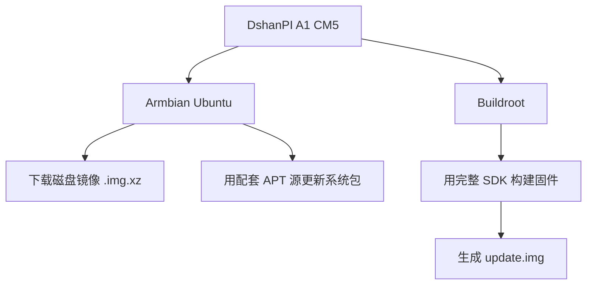

# 资料与版本关系

首次烧录时，直接按系统选择成品镜像。需要查原理图、编译固件或核对软件版本时，再使用下表中的资料。[选择系统与下载镜像](../1-QuickStart/01-Resources.md)

## 按用途选择资料

| 任务 | 对应资料 |
| --- | --- |
| 核对实物版本、接口或封装 | [硬件资料](00-Hardware.md) |
| 下载 Armbian 镜像并核对 SHA-256 | [DshanPI A1 CM5 镜像发行页和校验文件](https://github.com/dshanpi/ArmBianOS/releases/tag/dshanpi-a1-cm5-2026.10.10-1) |
| 查 Armbian 的板级适配和构建脚本 | [ArmBianOS 源码](https://github.com/dshanpi/ArmBianOS) |
| 查发行元包、签名软件源和构建记录 | [dshanpi-build](https://github.com/dshanpi/dshanpi-build) |
| 查看板端软件源、Overlay 和更新选项 | [dspi-config](https://github.com/dshanpi/dspi-config) |
| 查 Buildroot 与内核适配文件 | [Buildroot 适配仓库](https://github.com/dshanpi/DshanPi-A1_CM5-BuildrootSDK) |
| 编译可烧录的 Buildroot 固件 | 使用已适配底板的完整 SDK，按[固件编译指南](../4-Development/01-BuildrootSDK.md#build-firmware)生成 `update.img`。 |

查看 Armbian 镜像与 Buildroot 固件的关系

## 核对教程使用的 Armbian 版本 {#本教程采用的镜像基线}

| 核对项 | 教程使用的版本 |
| --- | --- |
| 板型标识 | `dshanpi-a1-cm5` |
| 镜像发行号 | `2026.10.10-1`，提供 GNOME 桌面版和 CLI 命令行版 |
| 系统与架构 | Ubuntu 24.04 Noble，ARM64 |
| Armbian revision | `25.11.0-trunk.20261010.1` |
| 内核版本标识 | `6.1.115` |

该版在 2026 年 11 月 12 日核对时标记为预发布。需要重现构建时，从同一发行页下载 `release-provenance.json`，按其中记录的源码版本核对。更新已安装的系统前，先检查配套软件包。[系统更新与恢复](../3-Maintenance/01-UpdateRecovery.md)

## 记录使用的版本

保存核心板规格、底板丝印版本、镜像完整文件名、下载地址和 SHA-256。进入系统后记录 `uname -r` 的输出；反馈问题时，将这些信息与首次报错一并提供。[问题反馈模板](../3-Maintenance/02-Troubleshooting.md#反馈模板)
