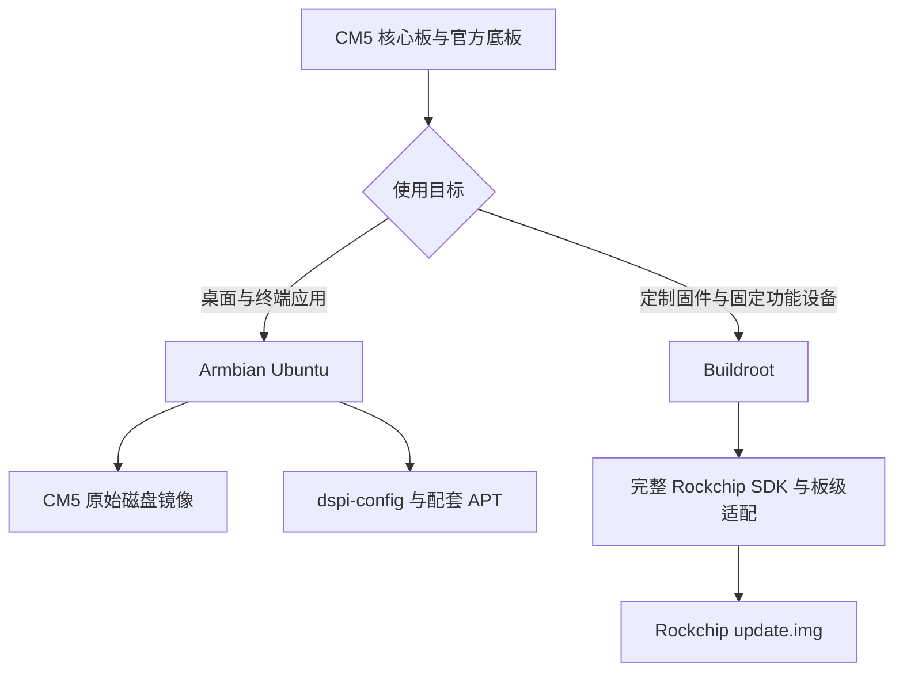

# 资料与版本关系

CM5 的硬件资料、可下载镜像、板端配置工具和系统源码分布在不同入口。选择资源时先确定自己要完成的操作，再核对板型和版本。

## 按用途选择资料

| 入口 | 包含什么 | 适合谁 |
| --- | --- | --- |
| [CM5 硬件资料](00-Hardware.md) | 底板原理图、位号图、开源 PCB 工程与硬件版本说明 | 查找接口定义、器件位置或修改底板的用户 |
| [CM5 硬件资料帖](https://forums.100ask.net/t/topic/10577) | 核心板尺寸、封装、原理图、位号图与镜像入口 | 核对硬件或查找资料的用户 |
| [CM5 Armbian 镜像发行页](https://github.com/dshanpi/ArmBianOS/releases#release-dshanpi-a1-cm5-2026.10.10-1) | CM5 系统镜像、校验文件与发行说明 | 首次安装和恢复系统的用户 |
| [dspi-config](https://github.com/dshanpi/dspi-config) | 板端状态、Overlay、软件源、升级与回滚工具 | 已经运行配套 Armbian 镜像的用户 |
| [ArmBianOS](https://github.com/dshanpi/ArmBianOS) | 基于 Armbian 的板级适配和镜像构建框架 | 系统与驱动开发者 |
| [DshanPi-A1_CM5-BuildrootSDK](https://github.com/dshanpi/DshanPi-A1_CM5-BuildrootSDK) | 部分 Buildroot 与内核适配文件 | Buildroot 开发者 |
| [dshanpi-build](https://github.com/dshanpi/dshanpi-build) | 产品版本、配套包、签名 APT 和镜像发行编排 | 系统维护与发行人员 |

首次安装只需要对应板型的镜像、校验文件、下载工具与匹配 Loader。源码仓库不等同于可以刷入的系统镜像。

## CM5 核心板图

CM5 V1.0 核心板正反面 PCB 图已集中放在 [硬件资料](00-Hardware.md) 中；该页同时提供官方底板原理图、位号图与开源 PCB 工程。核心板与底板版本分别核对。

## 两条系统路线

Armbian 使用 Ubuntu 软件包和板级 BSP，Buildroot 使用 SDK 构建的根文件系统。两者的镜像格式、账号、服务管理和升级方式需要分别说明。

## 本教程采用的镜像基线

| 项目 | 对应值 |
| --- | --- |
| 产品 | `dshanpi-a1-cm5` |
| 系统 | Ubuntu 24.04 Noble，ARM64 |
| 系统发行号 | `2026.10.10-1` |
| Armbian revision | `25.11.0-trunk.20261010.1` |
| 发布方内核版本标识 | `6.1.115` |
| 镜像类型 | CLI 与 GNOME 桌面 |
| 2026 年 11 月 12 日的 Release 状态 | Pre-release |

来源为 [该版 Release](https://github.com/dshanpi/ArmBianOS/releases/tag/dshanpi-a1-cm5-2026.10.10-1) 及其 `release-provenance.json`。镜像的源码版本由发行记录固定，不能用仓库当前 main 分支直接代替。

## 现有资料中的差异

### A1 与 CM5 的说明需要区分

原 A1 文档已有详细刷机步骤，可用于理解工具界面；CM5 的电源口、下载口、MASKROM 和实际供电规格须按 [CM5 底板硬件资料](00-Hardware.md) 核对。原理图、位号图与实物应使用匹配版本，具体接线和刷机顺序还需实板验证。

摄像头等外设的“支持”可能指适配源码、镜像内有驱动或已经实板测试。教程按实际镜像说明范围，不将通用产品功能表当作全部版本的验收结果。

### 公开 Buildroot 文件不是完整 SDK

2026 年 11 月 12 日检查时，公开 Buildroot 仓库根目录仅有 `buildroot` 与 `kernel`，不包含完整 SDK 的构建入口。现场完整 SDK 另有 CM5 底板和三摄等本地适配，因此不能直接把公开仓库 clone 后的内容当成同一份可复现固件源码。

开发者应先明确完整 SDK 基线、差分来源和配置，详见 [认识 Buildroot 与 SDK](../4-Development/01-BuildrootSDK.md)。

### 镜像与公开更新包的对应关系

同日检查时，CM5 的公开 stable 索引为空，testing 元包列出 `2026.10.08-3` 和 `2026.10.09-1`；镜像声明的 `25.11.0-trunk.20261010.1` headers 链接返回 404。

这影响同版包重装和外部模块编译，并不表示镜像内部一定缺少相关文件。完整条件与操作范围见 [系统更新与恢复](../3-Maintenance/01-UpdateRecovery.md)。

## 如何记录自己的环境

记录核心板规格、底板 PCB 版本、镜像完整文件名、下载页面与 SHA-256。进入系统后再记录板型标识、系统发行号和运行内核。反馈问题时使用这些信息，避免只写“RK3576 的 Ubuntu”。
