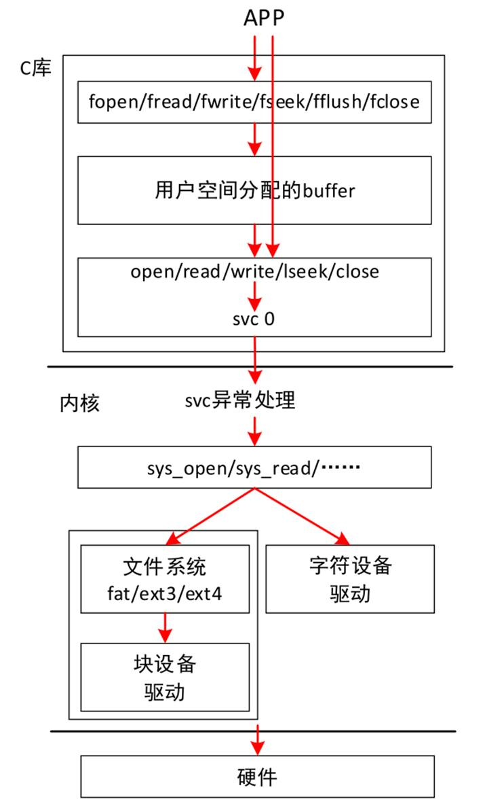
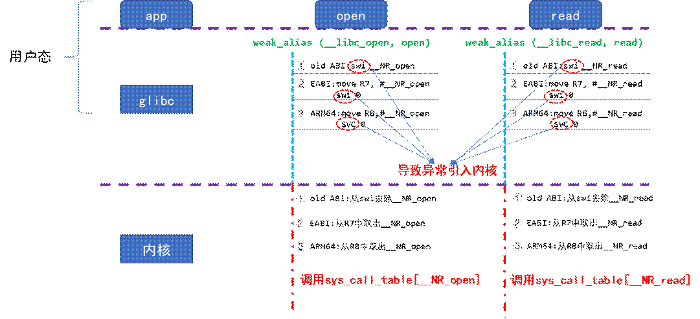
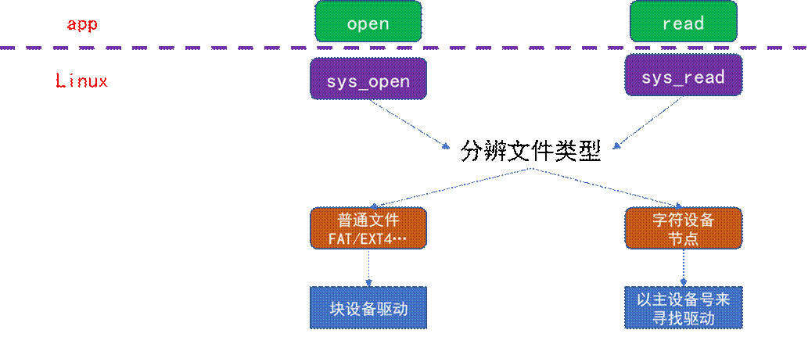

从打开一个文件入手，理解文件描述符、读写长度和文件偏移。 [直接进入 DshanPI A1 CM5 实验](#cm5-lab)。

## 1 区分标准 I/O 和文件描述符



*标准 I/O 与文件 I/O 的调用路径*

`fopen` 返回 `FILE *`，后续用 `fread`、`fwrite`、`fclose` 操作，C 库可以在用户空间缓冲数据。`open` 返回一个整数文件描述符（fd），后续交给 `read`、`write` 和 `close`。看到函数参数的类型，就能判断一段代码使用哪套接口。

## 2 打开、创建并读写文件

| 操作 | 典型调用 | 检查什么 |
| --- | --- | --- |
| 打开已有文件 | `open(path, O_RDONLY)` | 返回非负 fd；失败返回 `-1`，用 `perror` 查看原因 |
| 创建并覆盖文件 | `open(path, O_WRONLY \| O_CREAT \| O_TRUNC, 0644)` | `O_CREAT` 需要提供创建权限，实际权限还受 `umask` 影响；`O_TRUNC` 会清空已有内容 |
| 追加内容 | `open(path, O_WRONLY \| O_APPEND)` | 每次写入定位到文件末尾 |
| 写数据 | `write(fd, buf, len)` | 返回实际写入的字节数。短写时，从未写完的位置继续 |
| 读数据 | `read(fd, buf, sizeof(buf))` | 正数是实际读取的字节数，0 表示普通文件已到末尾，负数表示错误 |
| 关闭文件 | `close(fd)` | 释放描述符，检查返回值以发现关闭时报告的错误 |

`read` 按字节返回数据，不会自动在末尾补字符串结束符。页末示例把实际读到的字节数交给 `fwrite`，这样即使缓冲区已满，也能按正确长度输出。

## 3 跟踪系统调用，理解文件偏移



*用户程序通过系统调用进入内核*

应用调用 `read` 后，CPU 进入内核。内核根据进程的文件描述符表找到打开的文件，再把数据读入应用提供的缓冲区。



*内核对不同类型文件执行打开和读取操作*

普通文件和输入设备都能使用 `read`，但内核最终调用的实现不同。普通文件通常由文件系统提供数据；输入设备则可能等待下一次按键。图中内核函数名用于说明调用层次，具体实现随内核版本变化。

### 两次 open 与一次 dup 的区别

假设 `message.txt` 的内容为 `ABC`。打开文件得到 `fd`，再执行 `int copy = dup(fd);`。从 `fd` 读一个字节得到 `A`，从 `copy` 接着读一个字节就会得到 `B`，因为两个描述符共享同一打开文件的偏移。若另外调用一次 `open`，新描述符的偏移独立，会从 `A` 开始。每个成功获得的描述符都需要分别关闭。

## 4 在 DshanPI A1 CM5 上写入并读回文件 {#cm5-lab}

### 1. 写入和读回同一个文件

在开发板终端运行以下命令，将代码保存为 `file_demo.c`。示例每次运行都会重写当前目录的 `message.txt`。

**准备练习目录。**

```bash
mkdir -p ~/cm5-labs/files
cd ~/cm5-labs/files
```

**打开源文件。** 把下面的 C 程序保存到 `file_demo.c`。

```bash
nano file_demo.c
```

```c
#include <fcntl.h>
#include <stdio.h>
#include <unistd.h>

int main(void)
{
    const char message[] = "Hello from CM5\n";
    char buffer[64];
    int fd = open("message.txt", O_WRONLY | O_CREAT | O_TRUNC, 0644);
    if (fd < 0) { perror("open for writing"); return 1; }
    ssize_t count = write(fd, message, sizeof(message) - 1);
    if (count != (ssize_t)(sizeof(message) - 1)) {
        fputs("Incomplete write\n", stderr);
        close(fd);
        return 1;
    }
    if (close(fd) < 0) { perror("close"); return 1; }

    fd = open("message.txt", O_RDONLY);
    if (fd < 0) { perror("open for reading"); return 1; }
    while ((count = read(fd, buffer, sizeof(buffer))) > 0) {
        if (fwrite(buffer, 1, count, stdout) != (size_t)count) {
            perror("stdout");
            close(fd);
            return 1;
        }
    }
    if (count < 0) { perror("read"); close(fd); return 1; }
    return close(fd) < 0;
}
```

`open` 返回文件描述符；`write` 和 `read` 返回实际传输的字节数。`read` 返回 0 表示已读到文件末尾。

### 2. 核对内容和长度

**编译并运行程序。** 程序会写入练习目录中的 `message.txt`。

```bash
gcc -Wall -Wextra file_demo.c -o file_demo
./file_demo
```

**检查生成的文件。** `cat` 显示内容，`wc -c` 统计字节数。

```bash
cat message.txt
wc -c message.txt
```

程序和 `cat` 都应显示 `Hello from CM5`。`wc` 显示 `15 message.txt`，其中包括结尾的换行符。
