顺着一次按键找到设备节点，读懂事件类型、键码和按键状态。 [直接进入 DshanPI A1 CM5 实验](#cm5-lab)。

## 1 从硬件动作到用户态事件

接在开发板上的键盘、鼠标和触摸屏都可以通过 Linux 输入子系统上报事件。键盘上报哪个键发生变化，鼠标通常上报相对位移，触摸屏通常上报绝对坐标。

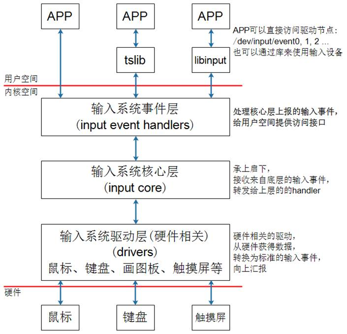

*从输入设备驱动到用户程序的事件路径*

沿图从下向上看：设备驱动采集硬件数据，输入核心把事件交给处理程序，`evdev` 再通过 `/dev/input/eventN` 提供给应用。应用可直接读取事件，也可通过 libinput 等库处理设备差异。

### 一条事件包含什么

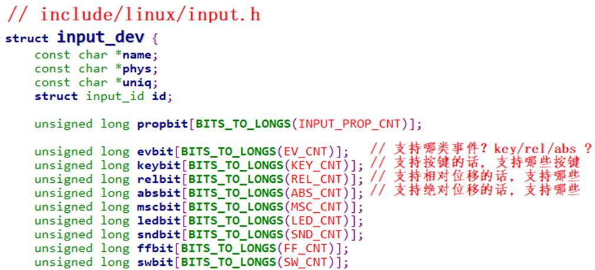

*内核中描述输入设备的 input_dev*

内核使用 `input_dev` 描述设备及其支持的事件。应用读取到的是 `struct input_event`，其中包含时间戳、`type`、`code` 和 `value`。

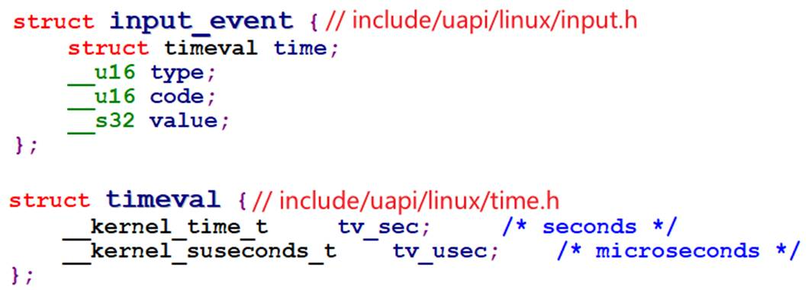

*应用读取的 input_event 结构体*

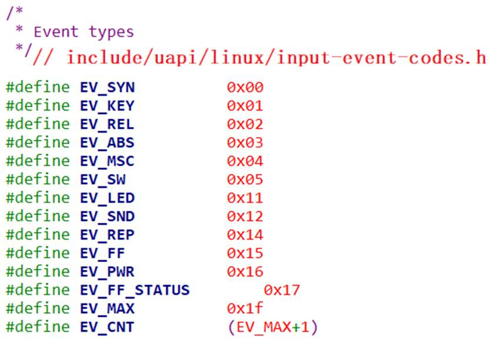

*Linux 输入事件的类型*

| 类型 | 怎样解读 |
| --- | --- |
| `EV_KEY` | `code` 确定按键，`value` 为 1 表示按下，0 表示松开，2 表示自动重复 |
| `EV_REL` | 如 `REL_X`，数值是相对于上一次的位置变化 |
| `EV_ABS` | 如 `ABS_X`，数值是设备坐标范围内的绝对位置 |
| `EV_SYN` | `SYN_REPORT` 标记一组相关事件已上报完毕 |

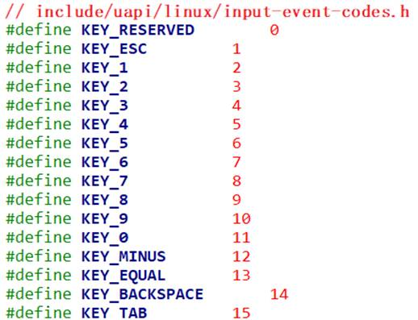

*EV_KEY 的键码定义*

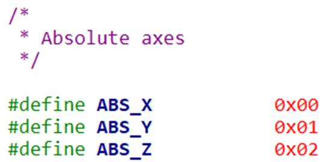

*EV_ABS 的坐标轴定义*

例如同一次触摸可能同时产生 X、Y 和同步事件。读取一组事件后再解释坐标，才能把同一次动作的横纵位置配对。

## 2 查找设备并读取能力

运行 `ls -l /dev/input/event*` 可列出节点。要知道每个节点对应哪个设备，在开发板终端运行 `cat /proc/bus/input/devices`。找到目标设备的 `N: Name`，再看同一段的 `H: Handlers`，其中的 `eventN` 对应设备节点。

`I:` 列出总线类型、厂商与产品 ID；`P:` 是物理路径；`S:` 是 sysfs 路径；`B:` 是设备能力位图。两个设备名称相似时，可结合物理路径和能力区分。

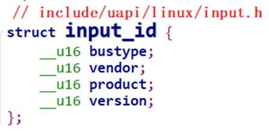

*input_id 中的总线类型与设备标识*

应用打开节点后，可用 `EVIOCGNAME` 读取名称，`EVIOCGID` 读取设备标识，`EVIOCGBIT` 查询支持的事件类型或按键。触摸设备还可用 `EVIOCGABS(ABS_X)` 获取坐标轴范围。

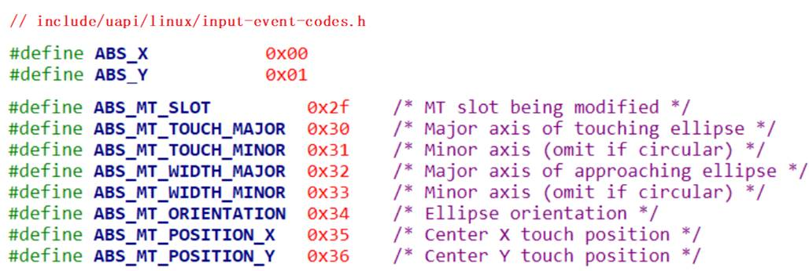

*绝对坐标轴和多点触摸的事件代码*

## 3 为应用选择读取方式


*应用等待设备输入的四种方式*

| 方式 | 数据尚未到达时 | 适用情况 |
| --- | --- | --- |
| 非阻塞查询 | `open` 带 `O_NONBLOCK`；`read` 可能返回 `-1` 并设置 `EAGAIN` | 程序已有主循环，每轮顺便处理输入 |
| 阻塞读取 | `read` 等待有事件时返回 | 只等待一个键盘，例如页末的 F6 实验 |
| `poll` / `select` | 同时等待多个描述符就绪，也可以设置超时 | 同时处理键盘、网络或定时任务 |
| 异步通知 | 设备就绪后以 `SIGIO` 等信号通知进程 | 应用需要把就绪通知纳入已有的信号处理流程 |

### 如何查询设备信息

`ioctl(fd, request, arg)` 的请求码包含操作类型、序号、数据方向和大小等信息。下面两图用输入设备请求说明这些字段，以及缓冲区长度如何进入请求码。实际编程使用 Linux 头文件定义的宏。

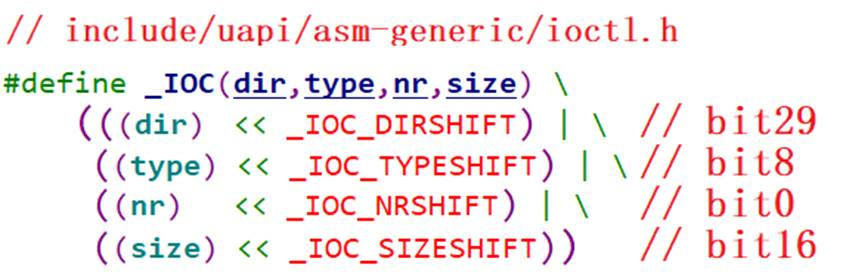

*ioctl 请求码的字段*


*EVIOCGBIT 如何在请求码中指定缓冲区大小*

### 从阻塞读取扩展到 poll、select 和异步通知

使用 `poll` 时将输入设备的 `events` 设为 `POLLIN`。返回 0 表示超时，返回正数后检查 `revents`，在可读时调用 `read`。`select` 则需要在每次调用前重新准备描述符集合，并在返回后用 `FD_ISSET` 判断哪个节点就绪。

使用异步通知时，先用 `sigaction` 安装信号处理函数，再用 `fcntl` 的 `F_SETOWN` 指定接收进程，并在原文件状态标志上加 `O_ASYNC`。处理函数可以设置 `volatile sig_atomic_t` 标志，由主循环读取事件。

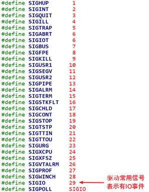

*异步通知使用的信号定义*

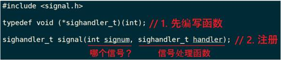

*注册信号处理函数的接口*

## 4 在 DshanPI A1 CM5 上读取 F6 按键事件 {#cm5-lab}

在 DshanPI A1 CM5 上接好 USB 键盘。Linux 通过 `/dev/input/event*` 提供输入事件，编号可能随外设和启动顺序改变。

### 1. 找到键盘

在开发板终端运行：

```bash
ls -l /dev/input/by-path/*-event-kbd
```

选一条与 USB 键盘对应的路径，复制从 `/dev/input/by-path/` 开始、到 `-event-kbd` 结束的部分。在下面的提示后粘贴路径并回车：

**选择键盘节点。** 按提示输入刚查到的完整路径，保存在当前终端的变量中。

```bash
read -r -p "Keyboard device: " keyboard
```

**查看键盘事件。** 运行后按一次 F6，观察按下和松开的两条记录。

```bash
evtest "$keyboard"
```

轻按并松开 **F6**。找到 `EV_KEY`、`KEY_F6` 两行，`value 1` 表示按下，`value 0` 表示松开。按 **Ctrl + C** 退出。遇到 `Permission denied` 时用 `sudo evtest "$keyboard"`；找不到命令时安装 `evtest`。

### 2. 用 C 程序读取一次按键

在开发板的同一终端创建并进入练习目录。

```bash
mkdir -p ~/cm5-labs/input
cd ~/cm5-labs/input
```

用编辑器打开 `key.c`。粘贴下方代码后，按 **Ctrl+O**、**Enter** 保存，再按 **Ctrl+X** 返回终端。

```bash
nano key.c
```

```c
#include <fcntl.h>
#include <linux/input.h>
#include <stdio.h>
#include <unistd.h>

int main(int argc, char **argv)
{
    if (argc != 2) { fputs("Usage: key DEVICE\n", stderr); return 1; }
    int fd = open(argv[1], O_RDONLY);
    if (fd < 0) { perror("open"); return 1; }
    char name[128] = {0};
    if (ioctl(fd, EVIOCGNAME(sizeof(name)), name) < 0) {
        perror("EVIOCGNAME"); close(fd); return 1;
    }
    printf("Device: %s\nPress and release F6\n", name);
    struct input_event event;
    while (read(fd, &event, sizeof(event)) == sizeof(event)) {
        if (event.type != EV_KEY || event.code != KEY_F6) continue;
        if (event.value == 1) puts("F6 down");
        if (event.value == 0) { puts("F6 up"); close(fd); return 0; }
    }
    fputs("Input device stopped\n", stderr);
    close(fd);
    return 1;
}
```

```bash
gcc -Wall -Wextra key.c -o key
./key "$keyboard"
```

程序先显示设备名称，随后等待读取事件。按下并松开 **F6** 后，应依次显示 `F6 down` 和 `F6 up`，然后返回终端。
