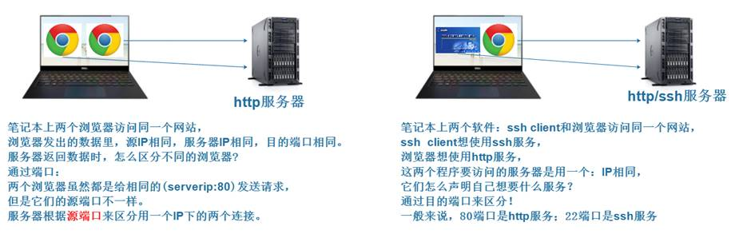
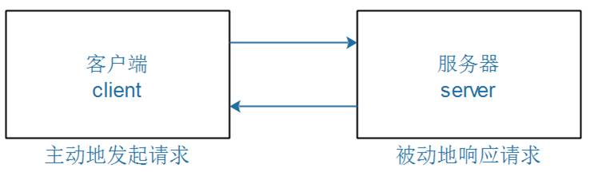
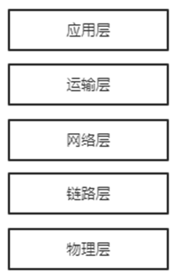
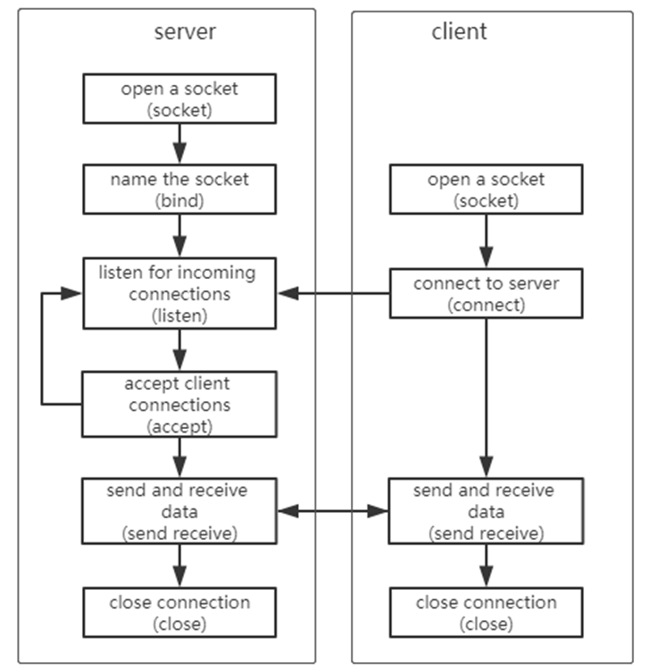
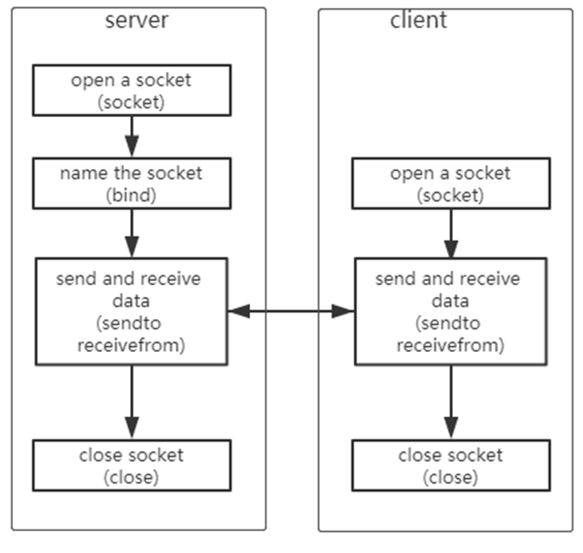

从 IP 地址和端口入手，分别跟踪 TCP 字节流与 UDP 数据报的收发过程。 [直接进入 DshanPI A1 CM5 实验](#cm5-lab)。

## 1 看懂通信双方的地址

IP 地址用来找到主机，端口用来找到该主机上接收数据的程序。看下图时，把源地址与源端口看作一端，目的地址与目的端口看作另一端。



*通信的源地址和目的地址*

### 客户端与服务端

服务端绑定一个约定的地址和端口，客户端使用该地址发起通信。服务端的回复发给客户端的源地址和端口。页末实验让两个程序都运行在 DshanPI A1 CM5 上，因此目标地址是 `127.0.0.1`。



*客户端与服务端的交互*

### TCP 与 UDP



*网络协议的分层*

应用数据向下经过传输层、IP 层和链路层，到达另一端后按相反顺序交给应用。C 程序通过套接字选择传输协议。

| 协议 | 应用收到的数据 | 编程上要处理什么 |
| --- | --- | --- |
| TCP | 可靠、有序的字节流 | 先建立连接。一次 `send` 的内容可能要多次 `recv` 才读完；多条应用消息应自行约定长度或分隔符 |
| UDP | 独立的数据报 | 使用 `sendto` 指定目的地，`recvfrom` 取得发送方地址。需要可靠性时，由应用处理超时、丢包或乱序 |



*TCP 客户端和服务端建立连接并传输字节流*



*UDP 客户端和服务端收发数据报*

## 2 对照调用顺序理解 socket API

| 调用 | 在程序中的作用 |
| --- | --- |
| `socket` | 创建描述符，IPv4 使用 `AF_INET`，TCP 选 `SOCK_STREAM`，UDP 选 `SOCK_DGRAM` |
| `bind` | 设置本地地址和端口。端口用 `htons` 转为网络字节序 |
| `listen`、`accept` | TCP 服务端开始监听，再取出一个已建立的连接。`accept` 返回新的描述符，用它处理这位客户端 |
| `connect` | TCP 客户端指定服务端地址，建立连接 |
| `send`、`recv` | 通过已连接的套接字收发字节；TCP 的 `recv` 对非零长度请求返回 0，表示对端已结束发送 |
| `sendto`、`recvfrom` | 按数据报发送和接收，并指定或取得对端地址 |

### TCP：监听描述符和连接描述符

服务端按 `socket → bind → listen → accept` 执行，再在 `accept` 返回的描述符上收发。客户端按 `socket → connect → send/recv` 执行。关闭某个连接后，服务器可以保留监听描述符，等待下一位客户端。页末的教学程序在回复一次后退出。

### UDP：记住回包地址

服务端按 `socket → bind → recvfrom → sendto` 执行。`recvfrom` 同时返回数据和发送方地址，回复时把该地址传给 `sendto`。客户端发出数据报后，用接收超时限制等待时间。对照页末的两个客户端，可以看到 TCP 先连接，而 UDP 的目的地址直接出现在发送调用中。

### 对照 C 客户端的地址写法

下面的片段与页末客户端使用同一个回环地址。TCP 客户端用 `connect(fd, (struct sockaddr *)&server, sizeof(server))` 连接；UDP 客户端把同一个 `server` 传给 `sendto`。

```c
struct sockaddr_in server = {
    .sin_family = AF_INET,
    .sin_port = htons(35760),
    .sin_addr.s_addr = htonl(INADDR_LOOPBACK)
};
```

接收文本时按 `recv` 或 `recvfrom` 的返回值处理实际字节数；套接字接口不会自动添加字符串结束符。

## 3 在 DshanPI A1 CM5 上验证 TCP 和 UDP 回显 {#cm5-lab}

用两个 DshanPI A1 CM5 桌面终端完成练习。服务端绑定本机回环地址 `127.0.0.1` 和端口 `35760`，可以在没有网线时运行。

### 1. 编译回显服务端

在第一个终端创建练习目录，用 `nano echo.c` 保存以下代码：

```bash
mkdir -p ~/cm5-labs/network
cd ~/cm5-labs/network
```

```c
#include <arpa/inet.h>
#include <stdio.h>
#include <string.h>
#include <unistd.h>

int main(int argc, char **argv)
{
    if (argc != 2 || (strcmp(argv[1], "tcp") && strcmp(argv[1], "udp"))) {
        fputs("Usage: echo tcp|udp\n", stderr);
        return 1;
    }
    int tcp = strcmp(argv[1], "tcp") == 0;
    int fd = socket(AF_INET, tcp ? SOCK_STREAM : SOCK_DGRAM, 0);
    if (fd < 0) { perror("socket"); return 1; }
    int reuse = 1;
    if (setsockopt(fd, SOL_SOCKET, SO_REUSEADDR, &reuse, sizeof(reuse)) < 0) {
        perror("setsockopt"); return 1;
    }
    struct sockaddr_in local = {
        .sin_family = AF_INET, .sin_port = htons(35760),
        .sin_addr.s_addr = htonl(INADDR_LOOPBACK)
    };
    if (bind(fd, (struct sockaddr *)&local, sizeof(local)) < 0) {
        perror("bind"); return 1;
    }

    char byte;
    if (tcp) {
        if (listen(fd, 1) < 0) { perror("listen"); return 1; }
        puts("TCP ready");
        int client = accept(fd, NULL, NULL);
        if (client < 0) { perror("accept"); return 1; }
        if (recv(client, &byte, 1, 0) != 1 || send(client, &byte, 1, 0) != 1)
            return 1;
        close(client);
    } else {
        puts("UDP ready");
        struct sockaddr_in peer;
        socklen_t size = sizeof(peer);
        if (recvfrom(fd, &byte, 1, 0, (struct sockaddr *)&peer, &size) != 1 ||
            sendto(fd, &byte, 1, 0, (struct sockaddr *)&peer, size) != 1)
            return 1;
    }
    close(fd);
    return 0;
}
```

```bash
gcc -Wall -Wextra echo.c -o echo
./echo tcp
```

看到 `TCP ready` 后，让这个终端等待连接。程序每次只回显一个字节，随后退出。

### 2. 在第二个终端测试 TCP

运行下方 Python 客户端。`connect` 先建立连接，再发送字母 `T`。终端应打印 `T`。

```bash
python3 - <<'PY'
import socket
with socket.create_connection(("127.0.0.1", 35760), timeout=5) as client:
    client.sendall(b"T")
    print(client.recv(1).decode())
PY
```

### 3. 换用 UDP

在第一个终端运行 `./echo udp`，看到 `UDP ready` 后，在第二个终端运行：

```bash
python3 - <<'PY'
import socket
with socket.socket(socket.AF_INET, socket.SOCK_DGRAM) as client:
    client.settimeout(5)
    client.sendto(b"U", ("127.0.0.1", 35760))
    data, peer = client.recvfrom(1)
    print(data.decode(), peer)
PY
```

输出应为 `U ('127.0.0.1', 35760)`。UDP 的 `recvfrom` 同时给出数据和发送方地址，服务端用这个地址回包。
