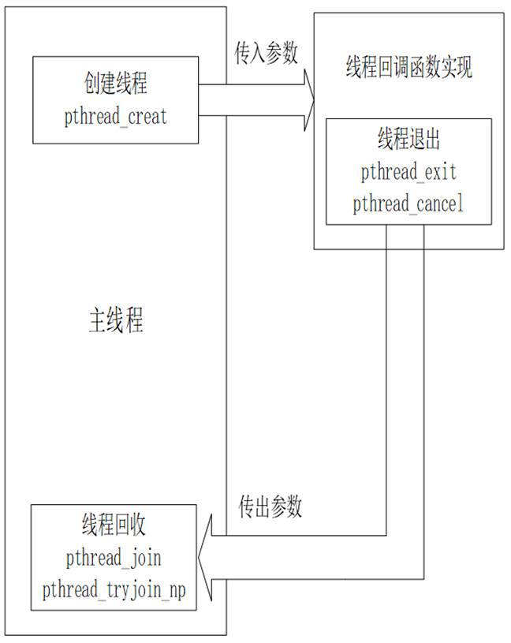

从创建工作线程开始，学习如何回收线程、保护共享数据和等待条件。 [直接进入 DshanPI A1 CM5 实验](#cm5-lab)。

## 1 从创建到回收一个线程

播放器既要连续播放，也要等待用户按键。把输入和播放交给不同线程，一个线程等待输入时，另一个线程仍可运行。同一进程的线程共享全局变量、堆和打开的文件，各自拥有调用栈。

### 创建线程并传入参数

`pthread_create(&tid, NULL, worker, arg)` 创建线程，工作函数签名为 `void *worker(void *arg)`。`pthread_t` 标识 POSIX 线程，可用 `pthread_self` 取得当前线程标识，用 `pthread_equal` 比较两个标识。

第四个参数只传递一个指针。若需要把编号、次数等信息一起交给线程，可将它们放在一个结构体中。结构体要存活到工作线程用完为止；在循环里创建多个线程时，每个线程需要独立编号就为它各留一份参数。

### 退出、取消和回收

工作函数 `return` 或调用 `pthread_exit` 会结束当前线程。对于可连接线程，主线程通过 `pthread_join` 等待它结束并回收资源，第二个参数可以取得线程返回值。返回指针应指向调用者仍可访问的数据。`pthread_cancel` 提出取消请求，线程实际退出取决于取消状态和取消点。设置为 detached 的线程退出后自动回收。



*线程的创建、执行、退出与回收*

## 2 保护共享数据，协调执行顺序

### 互斥锁：保护同一个计数器

`++count` 涉及读取、加一和写回。两个线程同时执行时会产生数据竞争。用同一把互斥锁将整段更新括在 `pthread_mutex_lock` 和 `pthread_mutex_unlock` 之间，再由主线程在 `pthread_join` 后读出结果。静态锁可用 `PTHREAD_MUTEX_INITIALIZER` 初始化，需要尝试而不等待时可用 `pthread_mutex_trylock`。


### 信号量：等到任务或资源可用

当一个线程准备数据、另一个线程消费数据时，可将进程内共享的信号量用 `sem_init(&ready, 0, 0)` 初始化为零。生产者准备好一份数据后调用 `sem_post`，消费者调用 `sem_wait`，取得一个计数后再处理。需要立即返回时使用 `sem_trywait`。所有使用者退出后再调用 `sem_destroy`。


### 条件变量：等待共享状态满足条件

例如消费者要等到队列非空。用互斥锁保护队列和条件，用 `while` 反复检查。`pthread_cond_wait` 会释放锁并等待，返回时已重新取得这把锁。

```c
pthread_mutex_lock(&lock);
while (queue_empty())
    pthread_cond_wait(&available, &lock);
take_one_item();
pthread_mutex_unlock(&lock);
```

生产者在同一把锁的保护下加入数据，再用 `pthread_cond_signal` 唤醒一个等待者；需要通知所有等待者时用 `pthread_cond_broadcast`。可能有多个消费者竞争同一项数据，所以被唤醒后仍要检查队列。示例中的 `queue_empty` 和 `take_one_item` 代表应用自己的队列操作。

## 3 在 DshanPI A1 CM5 上验证双线程计数 {#cm5-lab}

### 1. 创建两个工作线程

在开发板的同一终端创建并进入练习目录。

```bash
mkdir -p ~/cm5-labs/threads
cd ~/cm5-labs/threads
```

用编辑器打开 `counter.c`。粘贴下方代码后，按 **Ctrl+O**、**Enter** 保存，再按 **Ctrl+X** 返回终端。

```bash
nano counter.c
```

```c
#include <pthread.h>
#include <stdio.h>
#include <stdlib.h>
#include <string.h>

static int count;
static pthread_mutex_t lock = PTHREAD_MUTEX_INITIALIZER;

static void check(int error)
{
    if (error) {
        fprintf(stderr, "pthread: %s\n", strerror(error));
        exit(EXIT_FAILURE);
    }
}

static void *increment(void *arg)
{
    int times = *(const int *)arg;
    for (int i = 0; i < times; ++i) {
        check(pthread_mutex_lock(&lock));
        ++count;
        check(pthread_mutex_unlock(&lock));
    }
    return NULL;
}

int main(void)
{
    pthread_t workers[2];
    int times = 10000;
    for (int i = 0; i < 2; ++i)
        check(pthread_create(&workers[i], NULL, increment, &times));
    for (int i = 0; i < 2; ++i)
        check(pthread_join(workers[i], NULL));
    printf("count = %d\n", count);
    check(pthread_mutex_destroy(&lock));
    return 0;
}
```

### 2. 编译并核对结果

```bash
gcc -Wall -Wextra -pthread counter.c -o counter
./counter
```

应输出 `count = 20000`。互斥锁保证一次只有一个线程更新 `count`；`pthread_join` 让主线程等两个工作线程退出后再打印结果。

将 `times` 改为 `5000`，重新编译并运行，输出应变为 `count = 10000`。
