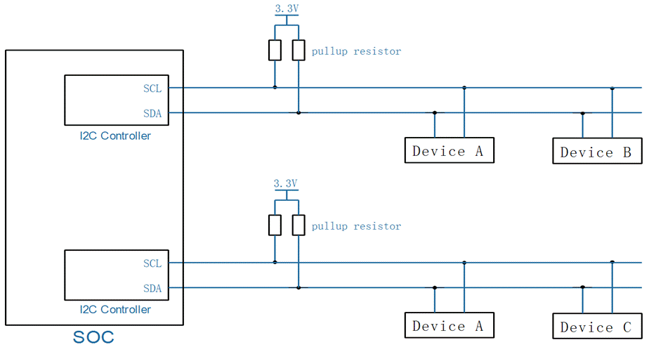
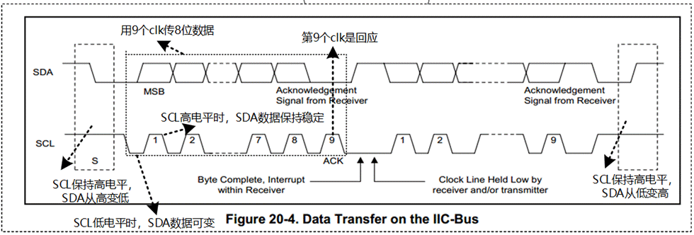
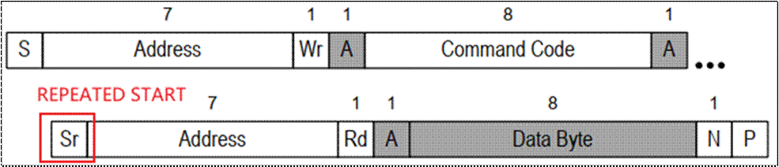
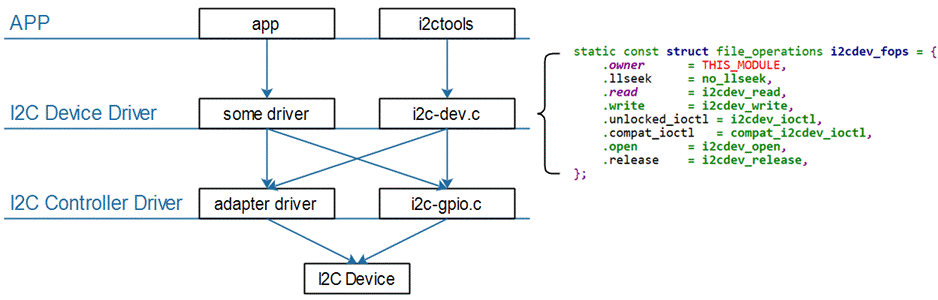

本章先介绍 I²C 硬件、协议和 Linux 软件接口，再用 DshanPI A1 CM5 底板上的 ES8388 做实验。已熟悉协议，可直接跳到[第 6 节：在 DshanPI A1 CM5 上找到 ES8388](#es8388)。

## 1 I²C 介绍

RK3576 通过 I²C4 配置底板的 ES8388。SCL 提供时钟，SDA 双向传输地址和数据。芯片配置走 I²C，播放和录音的采样数据走音频接口。



两条信号线由上拉电阻拉高。器件可以拉低信号线，释放后由上拉电阻恢复高电平。接外设时，要核对底板对应接口的电压域。

## 2 I²C 协议

控制器发出 START 后，先发送 **7 位设备地址和 1 位读写方向**。本板 ES8388 的设备地址是 `0x11`。寄存器地址由芯片手册定义，用来选择芯片内部的配置项。



每传输一个字节，接收方在第九个时钟给出 ACK 或 NACK。对于需要先指定寄存器再读取的芯片，控制器先写寄存器号，发出重复 START 后切换到读方向，读完最后一个字节后发出 NACK 和 STOP。



## 3 SMBus 协议

SMBus 规定了一组常用事务，例如读字节、写字节和读字。选择接口时，需要同时核对芯片要求的传输格式和控制器能力。在开发板终端运行 `sudo i2cdetect -F 4`，可查看 I²C4 支持的事务。每一项后面的 `yes` 或 `no` 表示控制器是否支持该操作。

## 4 Linux I²C 系统的重要结构体

| 内核结构 | 在本板示例中的作用 |
| --- | --- |
| `i2c_adapter` | 表示 I²C4 这条总线，控制器驱动提供传输方法 |
| `i2c_client` | 表示总线 4 上地址为 `0x11` 的 ES8388，绑定后可从 sysfs 查看驱动 |
| `i2c_msg` | 描述一段传输的地址、方向、长度和缓冲区。`i2c_transfer()` 可提交一条或多条消息 |

## 5 在用户空间访问 I²C 设备

`i2cdetect -l` 列出 Linux 已注册的适配器。`/dev/i2c-4` 是整条总线的接口，`/sys/bus/i2c/devices/4-0011` 是内核登记的 ES8388 设备。若缺少工具，在 Armbian 上运行 `sudo apt install i2c-tools`。

编写应用时，`I2C_FUNCS` 查询适配器能力，`I2C_RDWR` 提交一组 I²C 消息。本板的声卡驱动负责 ES8388 的寄存器读写，应用通过 ALSA 播放或录音。[Linux 用户空间 I²C 接口](https://docs.kernel.org/i2c/dev-interface.html)



## 6 在 DshanPI A1 CM5 上找到 ES8388 {#es8388}

DshanPI A1 CM5 V1.2 底板自带 **ES8388 音频编解码芯片**。它连接在 **I²C4** 上，7 位地址为 **`0x11`**。本节直接使用板载芯片，无需接线。[底板原理图，第 10 页](../1-QuickStart/Downloads.md#carrier-board)

### 6.1 找到 ES8388 {#1-找到-es8388}

在 DshanPI A1 CM5 桌面按 **Super**，搜索 `terminal` 并回车。输入：

```bash
cat /sys/bus/i2c/devices/4-0011/name
```

实板输出 `es8388`。路径中的 `4-0011` 就是这颗芯片在 Linux 中的位置：`4` 是总线号，`0011` 是十六进制地址 `0x11`。

### 6.2 确认驱动已接管地址 {#2-确认驱动已接管地址}

```bash
readlink -f /sys/bus/i2c/devices/4-0011/driver
```

本板输出 `/sys/bus/i2c/drivers/ES8323`。`ES8323` 是当前内核为 ES8388 绑定的驱动名。看到该路径后，用下面的命令只查看地址 `0x11`：

```bash
sudo i2cdetect -y 4 0x11 0x11
```

找到左侧 **`10:` 行**与顶部 **`1` 列**的交点，即地址 `0x11`。实板在这里显示 **`UU`**，表示内核驱动已占用该地址，工具会跳过探测。如果找不到 `i2cdetect` 命令，运行 `sudo apt install i2c-tools`。

### 6.3 找到对应的声卡 {#3-找到对应的声卡}

```bash
cat /proc/asound/cards
```

找到包含 **`rockchip-es8388`** 的一行。本板输出如下，行首的 `0` 是 ALSA 分配的声卡编号：

```text
 0 [rockchipes8388 ]: rockchip-es8388 - rockchip-es8388
```

至此已从 I²C 设备找到对应声卡。要测试实际录音和播放，继续阅读[音频功能测试](../SystemConfig/04-AudioConfig.md)。

<details>
<summary>用 C 程序查询 ES8388 所在总线的能力</summary>

在开发板的同一终端创建并进入练习目录。

```bash
mkdir -p ~/cm5-labs/i2c
cd ~/cm5-labs/i2c
```

用编辑器打开 `caps.c`。粘贴下方代码后，按 **Ctrl+O**、**Enter** 保存，再按 **Ctrl+X** 返回终端。

```bash
nano caps.c
```

```c
#include <fcntl.h>
#include <linux/i2c.h>
#include <linux/i2c-dev.h>
#include <stdio.h>
#include <sys/ioctl.h>
#include <unistd.h>

int main(int argc, char **argv)
{
    if (argc != 2) { fputs("Usage: caps /dev/i2c-N\n", stderr); return 1; }
    int fd = open(argv[1], O_RDONLY);
    if (fd < 0) { perror("open"); return 1; }
    unsigned long capabilities;
    if (ioctl(fd, I2C_FUNCS, &capabilities) < 0) {
        perror("I2C_FUNCS"); close(fd); return 1;
    }
    printf("I2C: %s\n", capabilities & I2C_FUNC_I2C ? "yes" : "no");
    close(fd);
    return 0;
}
```

```bash
gcc -Wall -Wextra caps.c -o caps
sudo ./caps /dev/i2c-4
```

实测输出 `I2C: yes`，表示总线 4 的适配器支持 I²C 传输。

</details>

<details>
<summary>在本板的虚拟总线上练习寄存器读写</summary>

把[DshanPI A1 CM5 示例代码包](pathname:///downloads/cm5-appdev-examples.zip)解压到主目录。在开发板终端执行以下命令。脚本通过 `i2c-stub` 创建地址为 `0x68` 的模拟设备，ES8388 继续由声卡驱动管理。

```bash
sudo apt install i2c-tools python3-smbus gcc
sudo bash ~/cm5-examples/i2c-stub.sh
```

本板记录的输出如下。

```text
已写入 0x55
寄存器 0x01 的值 = 0x55
写寄存器失败: Operation not supported
```

前两行是 Python 通过 SMBus 写入并读回的值。最后一行来自 C 程序使用的原生 I²C 写操作，该模拟设备只支持 SMBus。验证这段 C 程序的实际收发需要另接可写的 I²C 器件。

</details>

<details>
<summary>另接 I²C 模块时，查看 40 针排针</summary>

DshanPI A1 CM5 V1.2 底板原理图第 5 页中，40 针排针 **U35 的 31 脚为 SDA、32 脚为 SCL**，对应 `I2C0_SDA_M0` 和 `I2C0_SCL_M0`。接线前核对模块的供电、上拉电压和 GND。[下载底板原理图](../1-QuickStart/Downloads.md#carrier-board)

在当前 Armbian 镜像上，执行：

**查找 I²C0 的设备树节点。** 两行命令将路径保存在当前终端的变量中。

```bash
dt=/sys/firmware/devicetree/base
node=$(tr -d '\0' < "$dt/aliases/i2c0")
```

**读取该节点的启用状态。** 将输出与下方的本板记录对照。

```bash
tr -d '\0' < "$dt$node/status"; echo
```

实测输出 `disabled`，设备列表中也没有 `/dev/i2c-0`。使用这组排针前，需要启用 I²C0 及对应的 M0 引脚复用，再确认设备节点出现。其他总线号对应不同线路。本次没有在排针上连接外设或验证寄存器读写。

</details>
