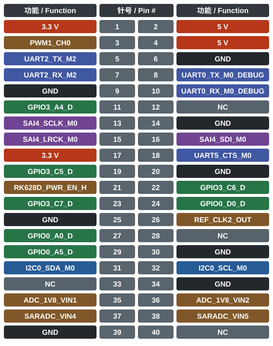

本实验在 DshanPI A1 CM5 的 Armbian 系统上进行。准备一块万用表和两根母头跳线，用 `gpioset` 切换底板 **U35 的 11 脚**，再用万用表观察它相对 **9 脚（GND）** 的电压变化。

## 1. 找到 11 脚和 9 脚

下图是 **V1.2 底板 U35** 的物理针号，左列为奇数，右列为偶数。看实物时，将底板正面朝上、40 针排针朝上、网口朝下。**靠板边的一排是偶数，靠核心板的一排是奇数**。从左端的 1、2 脚开始数，奇数排的第 5 根是 **9 脚**，第 6 根是 **11 脚**。[底板原理图第 5 页](https://dl.100ask.net/Hardware/MPU/RK3576-DshanPi-A1-CM5/SCH_DshanPI-A1-CM5-Base.pdf#page=5)



图中列出焊盘的接线功能。`NC` 表示 PCB 焊盘未分配网络。12 脚在原理图备注中列为 SAI4 MCLK，但 V1.2 PCB 未给该焊盘分配网络。10 脚经 D3 接调试串口 RX。1、17 脚的 3.3 V 和 2、4 脚的 5 V 均为电源；各信号脚的电压域需单独核对。[底板 PCB 工程](../../1-QuickStart/Downloads.md#carrier-board)

## 2. 接好万用表

1. 开发板断电，移除 11 脚上的其他外设。用跳线将万用表黑表笔（COM）接 **9 脚 GND**，红表笔（V）接 **11 脚 GPIO3_A4_D**。
2. 将万用表设为**直流电压档**，确认两根跳线互不短接，再给开发板上电。实验只使用这两个针脚。

## 3. 查找 GPIO 控制器和偏移 {#从引脚名找到控制器和偏移}

`GPIO3_A4_D` 中的 `GPIO3` 对应控制器标签 `gpio3`。A、B、C、D 四组依次从 0、8、16、24 开始计数，所以 **A4 的组内偏移为 4**。下面使用的是 libgpiod **1.x** 命令。

在开发板桌面按 **Super**，搜索 `terminal` 并打开。依次运行：

**安装工具并查看版本。** 后面的操作使用本页所示版本的命令格式。

```bash
sudo apt install gpiod
gpioset --version
```

**列出 GPIO 控制器。** 在输出中找实验引脚所属的控制器。

```bash
gpiodetect
```

本板实测版本为 `1.6.3`，控制器列表中有 `gpiochip3 [gpio3] (32 lines)`。如果设备编号不同，请把后续命令的 `gpiochip3` 换成实际列在 `[gpio3]` 前的名称。

**查看第 4 条 GPIO 线。** 留意这一行是否显示 `unused`。

```bash
gpioinfo gpiochip3 | grep -E 'line +4:'
```

**查看同一引脚的复用状态。** 确认没有驱动占用，再进行电平实验。

```bash
sudo grep -hE '^pin 100 ' /sys/kernel/debug/pinctrl/*/pinmux-pins
```

命令中的引脚编号 100 是 `3 × 32 + 4`。本板查询结果如下：

```text
line   4:      unnamed       unused   input  active-high
pin 100 (gpio3-4): (MUX UNCLAIMED) (GPIO UNCLAIMED)
```

看到 `unused`，并确认复用和 GPIO 均为 `UNCLAIMED` 后再继续。若显示其他使用者，或无法核对复用状态，请先检查当前镜像的引脚配置。

## 4. 切换电平并观察读数

1. **输出低电平。** 运行下列命令，保持程序运行，观察万用表。预期读数接近 **0 V**。记下读数后按 **Ctrl+C** 释放引脚。

   ```bash
   sudo gpioset -m signal gpiochip3 4=0
   ```

2. **输出高电平。** 运行下列命令，再读一次电压。预期读数升至该 GPIO 电压域的高电平。读数稳定后按 **Ctrl+C** 释放引脚，断电后拆线。

   ```bash
   sudo gpioset -m signal gpiochip3 4=1
   ```

`-m signal` 使程序在测量期间持续占用输出线。请在按 **Ctrl+C** 前读数；程序退出后的电平由后续引脚配置决定。

## 实测记录 {#cm5-实测步骤与结果}

在 DshanPI A1 CM5 上已核对工具版本、控制器标签、11 脚对应的 GPIO 线和复用状态。上节给出的是排针测量的预期现象，实际高、低电压值待接表测量。
