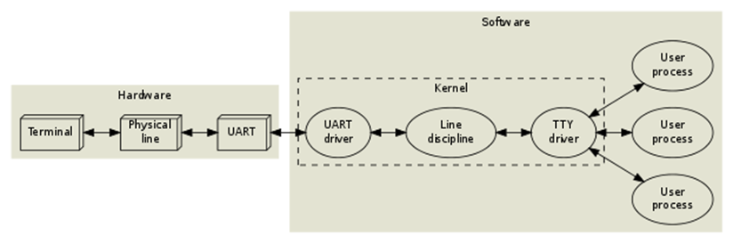
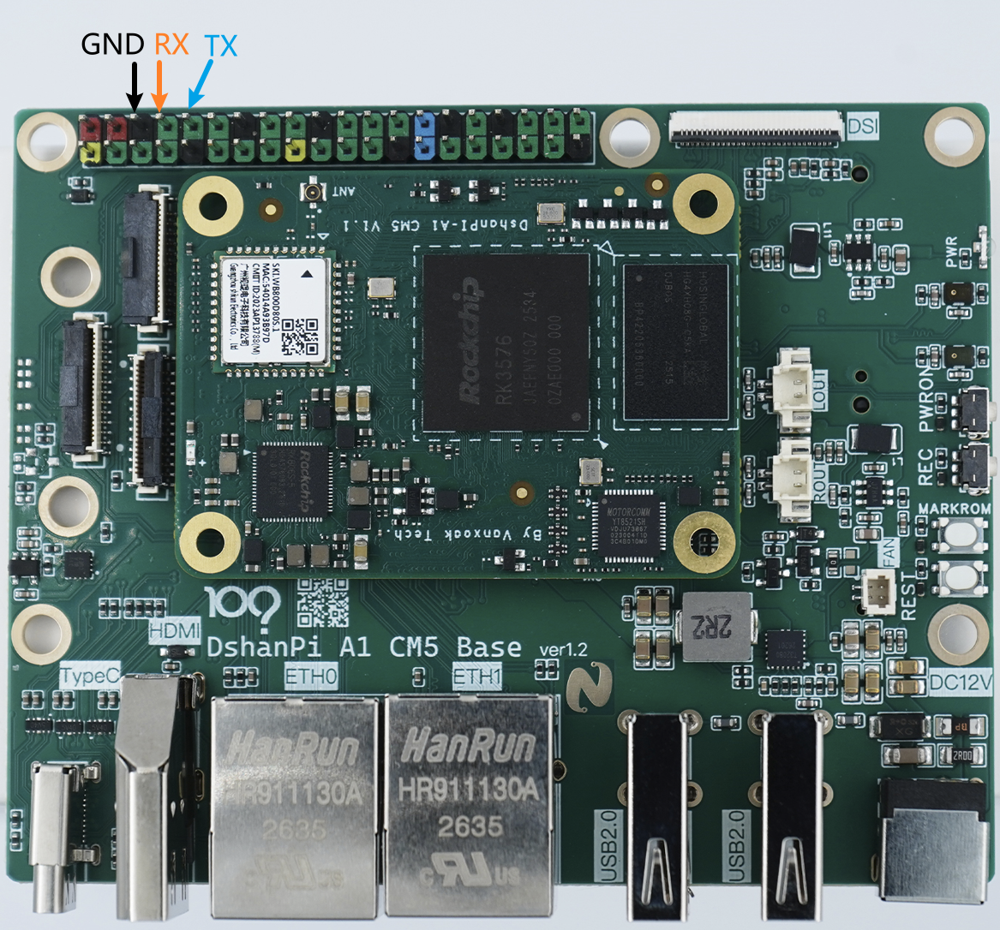

UART 通过 TX 发送、RX 接收，双方共地，并使用相同波特率和帧格式。Linux 应用通过 `termios` 设置串口，再用 `read` 和 `write` 收发数据。

## 配置串口并读回一个字符

程序用 `open` 打开串口设备，通过 `tcgetattr` 读取设置，再用 `tcsetattr` 应用波特率和帧格式。`8N1` 表示 8 个数据位、无校验、1 个停止位。原始模式让应用按字节收发，关闭回显可避免把终端回显误判为收到的数据。



| 设置 | 作用 |
| --- | --- |
| `cfsetispeed`、`cfsetospeed` | 分别设置输入和输出波特率 |
| `CLOCAL`、`CREAD` | 使用本地连接并启用接收器 |
| `VMIN`、`VTIME` | 非规范模式下，控制一次读取等待的最少字节数和超时 |
| `tcflush`、`tcsetattr` | 分别用于清理缓冲区和应用新的终端属性 |

## DshanPI A1 CM5 实测步骤与结果 {#cm5-实测步骤与结果}

### 识别调试串口

底板 U35 的 6、8、10 脚分别是 GND、板端 TX、板端 RX。使用 USB 转串口模块查看启动信息时，按图交叉连接 TX/RX，设置为 **1500000、8N1**。 [调试串口接线](../../1-QuickStart/HardwareConnections.md)



### 在板上运行收发程序

在 DshanPI A1 CM5 终端执行以下命令。程序创建一对伪终端，将接收端设为原始模式，再发送一行文字。

**查看串口设备名。**

```bash
ls -l /dev/ttyS*
```

**用软件模拟收发。** 将整段 Python 示例复制到同一终端，观察发送的文字能否读回。

```bash
python3 - <<'PY'
import os, pty, termios, tty
master, slave = pty.openpty()
tty.setraw(slave)
os.write(master, b"CM5-UART\n")
print(os.read(slave, 32).decode().strip())
attrs = termios.tcgetattr(slave)
print("raw mode:", not bool(attrs[3] & termios.ICANON))
os.close(master)
os.close(slave)
PY
```

本板打印 `CM5-UART` 和 `raw mode: True`。这个实验验证应用收发逻辑。若要验证电气收发，需要另接一组已配置的 UART 引脚与外部设备，调试控制台应保留给系统。

### 编译串口程序并回送一个字符

将[DshanPI A1 CM5 示例代码包](pathname:///downloads/cm5-appdev-examples.zip)解压到主目录，得到 `~/cm5-examples/`。在开发板终端编译原示例，再用伪终端回送字符 `A`。

**在示例目录编译串口程序。**

```bash
cd ~/cm5-examples
gcc -Wall serial_send_recv.c -o serial_send_recv
```

**启动回送测试。** 脚本用一对伪终端验证字符能否返回。

```bash
python3 uart_loop.py
```

```text
Enter a char: get: 41 A
```

`41` 是字符 `A` 的十六进制值，表示程序收到了它发出的同一字节。

**外接硬件**　本次验证应用程序收发。验证物理 TX/RX 还需在已启用的空闲 UART 上短接收发脚，或接入电平匹配的串口设备。
