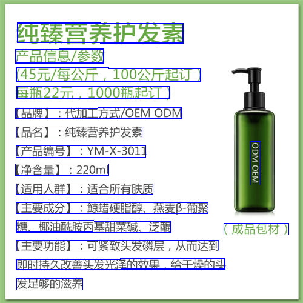

PP-OCR 分两步工作。检测模型找出文字区域，识别模型将每个区域转成字符串。保留示例的字典和检测参数，才能正确显示中文。

## 把文字检测框交给识别模型

PP-OCR 的检测器返回文字区域的四个角点。程序按阅读顺序排列检测框，对每个区域做透视裁剪，再由识别器根据词典解码文字。若图中有框但内容不对，先检查裁出的单行文字和识别字典。

## DshanPI A1 CM5 实测步骤与结果 {#cm5-实测步骤与结果}

### 在电脑上转换两个模型

**在电脑上进入模型仓库。** 先启用 RKNN 转换环境。

```bash
source ~/rknn-env/bin/activate
cd ~/Projects/rknn_model_zoo
```

**下载并转换两个模型。** 将下面的循环整段复制，分别生成文字检测和文字识别所用的 `.rknn` 文件。两次转换都完成后再继续。

```bash
for pair in 'Det ppocrv4_det' 'Rec ppocrv4_rec'; do
    set -- $pair
    app="$PWD/examples/PPOCR/PPOCR-$1"
    (cd "$app/model" && bash download_model.sh) || break
    (cd "$app/python" && python convert.py "../model/$2.onnx" rk3576 fp "../model/$2.rknn") || break
done
```

**编译识别程序并装入模型。** 最后一条把两个模型复制到板端示例的 `model` 目录。

```bash
bash build-linux.sh -t rk3576 -a aarch64 -d PPOCR-System
cp examples/PPOCR/PPOCR-{Det,Rec}/model/*.rknn install/rk3576_linux_aarch64/rknn_PPOCR-System_demo/model/
```

构建工具和目录约定见 [准备 RKNN 环境](./RKNNSetup.md)。将 `rknn_PPOCR-System_demo` 目录复制到 DshanPI A1 CM5 主目录。

### 在板上识别示例图

**在板上进入示例目录。** 第二条让程序找到随示例提供的运行库。

```bash
cd ~/rknn_PPOCR-System_demo
export LD_LIBRARY_PATH="$PWD/lib${LD_LIBRARY_PATH:+:$LD_LIBRARY_PATH}"
```

**识别测试图片。** 依次传入检测模型、识别模型和图片，核对下方结果。

```bash
./rknn_ppocr_system_demo model/ppocrv4_det.rknn model/ppocrv4_rec.rknn model/test.jpg
```

本板识别出「（成品包材）」，该行分数为 `0.706706`。打开 `out.jpg`，可用框的位置对照原图中的文字。



要测试实时场景，可按 [采集三帧摄像头画面](../Vision/Camera.md#把摄像头画面交给-npu) 保存图像，再将命令中的测试图片换为相应帧。

### 用 Python 识别图片和摄像头中的文字

将[DshanPI A1 CM5 示例代码包](pathname:///downloads/cm5-appdev-examples.zip)解压到主目录，得到 `~/cm5-examples/`。先按上文准备模型。下面先运行配套图片，再接摄像头运行同一个脚本。

**准备板端 Python 依赖。**

```bash
source ~/rknn-lite/bin/activate
sudo apt install python3-shapely python3-pyclipper python3-scipy
```

**先识别配套图片。** 在示例目录中运行脚本，核对输出的文字。

```bash
cd ~/rknn_PPOCR-System_demo
CM5_IMAGE=model/test.jpg python ~/cm5-examples/OCR.py --det_model_path model/ppocrv4_det.rknn --rec_model_path model/ppocrv4_rec.rknn
```

**接入摄像头后再测试。** 将设备路径换为本板实际的采集节点。

```bash
CM5_CAMERA=/dev/video42 python ~/cm5-examples/OCR.py --det_model_path model/ppocrv4_det.rknn --rec_model_path model/ppocrv4_rec.rknn
```

识别结果中的数字是对应文字的置信度。 本次示例图首项为 `纯臻营养护发素`，分数 `0.711`。

```text
processed: (480, 480, 3)
```

**外接硬件**　图片模式无需外设。实时模式已接 OV13850，在本板的 `/dev/video42` 连续处理了三帧，每帧缩放到 480 × 480。
