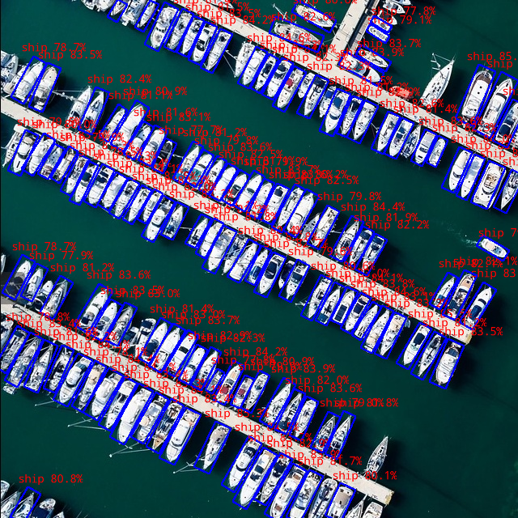

旋转框带有方向信息，适合从俯视图中分开斜向停靠的船只。示例会在终端打印框的位置、尺寸、角度与置信度。

## 读取旋转框的朝向

航拍场景中的船只可能斜向排列。旋转框用中心坐标、宽、高和角度描述目标。绘制四条边时，同时使用尺寸和角度。只取水平外接矩形会丢失朝向。在板端生成的结果图中检查各个框的长边是否沿着船身。

## DshanPI A1 CM5 实测步骤与结果 {#cm5-实测步骤与结果}

### 在电脑上准备模型与程序

先完成 [RKNN 环境搭建](./RKNNSetup.md)。若已有适用于 RK3576 的 `.rknn` 文件，按第 2 步的文件名放入第 1 步的模型目录，然后直接做第 3 步。首次从 ONNX 转换时，从第 1 步开始。

**1. 在电脑上下载原始模型。** 启用 RKNN 转换环境，再到示例的模型目录运行下载脚本。

```bash
source ~/rknn-env/bin/activate
cd ~/Projects/rknn_model_zoo/examples/yolov8_obb/model
bash download_model.sh
```

**2. 转换模型。** 进入转换脚本目录，为 RK3576 生成 `yolov8n-obb.rknn`。

```bash
cd ../python
python convert.py ../model/yolov8n-obb.onnx rk3576 fp ../model/yolov8n-obb.rknn
```

**3. 编译并打包。** 回到仓库根目录构建旋转框程序，再把模型复制到生成的示例目录。

```bash
cd ~/Projects/rknn_model_zoo
bash build-linux.sh -t rk3576 -a aarch64 -d yolov8_obb
cp examples/yolov8_obb/model/yolov8n-obb.rknn install/rk3576_linux_aarch64/rknn_yolov8_obb_demo/model/
```

### 在 DshanPI A1 CM5 上运行 {#在-cm5-上运行}

将生成的 `rknn_yolov8_obb_demo` 整个目录复制到板上主目录，打开终端。

**进入板上的示例目录。** 第二条命令让当前终端能找到程序配套的运行库。

```bash
cd ~/rknn_yolov8_obb_demo
export LD_LIBRARY_PATH="$PWD/lib${LD_LIBRARY_PATH:+:$LD_LIBRARY_PATH}"
```

**运行旋转框示例。** 使用示例自带的图片，对照下方的实测结果。

```bash
./rknn_yolov8_obb_demo model/yolov8n-obb.rknn model/test.jpg
```

本次 DshanPI A1 CM5 输出 `ship @ (26 70 19 58 angle=0.503913) 0.787`。模型转换精度或输入图变化时，框的位置和分数也会变化。



### 用 Python 绘制船舶旋转框

将[DshanPI A1 CM5 示例代码包](pathname:///downloads/cm5-appdev-examples.zip)解压到主目录，得到 `~/cm5-examples/`。在板端运行 Python 旋转框后处理，打开生成的图片可对照框的方向。

**准备板端 Python 环境。** 安装处理旋转框所需的几何库。

```bash
source ~/rknn-lite/bin/activate
sudo apt install python3-shapely
```

**在示例目录运行图片检测。**

```bash
cd ~/rknn_yolov8_obb_demo
python ~/cm5-examples/OBB.py --model_path model/yolov8n-obb.rknn --image model/test.jpg
```

```text
oriented boxes: 161
save image in ./result.jpg
```

本次使用配套船舶图片，无需摄像头。`161` 是 Python 示例按其阈值保留的旋转框数。
