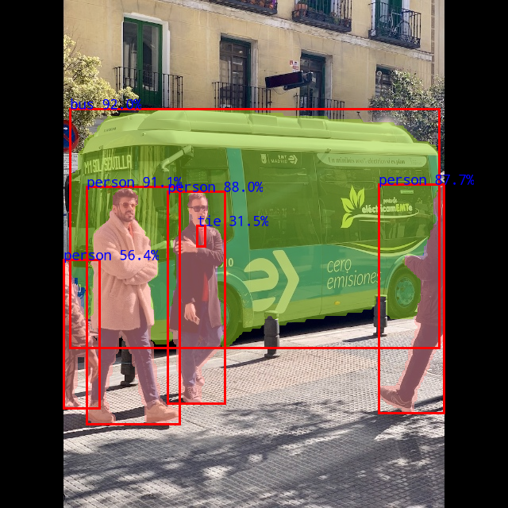

实例分割为每个目标生成独立的像素掩码。检测框定位车辆，掩码则沿车身轮廓覆盖图像。

## 将候选框和像素掩码配对

实例分割在检测框和类别之外，还输出掩码系数及共享的掩码原型。程序筛选候选框时保留对应的系数，组合出各实例的掩码，裁剪到各自框内，再叠加到原图。图中轮廓可以区分彼此靠近的行人和车辆。

## DshanPI A1 CM5 实测步骤与结果 {#cm5-实测步骤与结果}

### 在电脑上准备模型与程序

先完成 [RKNN 环境搭建](./RKNNSetup.md)。若已有适用于 RK3576 的 `.rknn` 文件，按第 2 步的文件名放入第 1 步的模型目录，然后直接做第 3 步。首次从 ONNX 转换时，从第 1 步开始。

**1. 在电脑上下载原始模型。** 启用 RKNN 转换环境，再到示例的模型目录运行下载脚本。

```bash
source ~/rknn-env/bin/activate
cd ~/Projects/rknn_model_zoo/examples/yolov8_seg/model
bash download_model.sh
```

**2. 转换模型。** 进入转换脚本目录，为 RK3576 生成 `yolov8s-seg.rknn`。

```bash
cd ../python
python convert.py ../model/yolov8s-seg.onnx rk3576 fp ../model/yolov8s-seg.rknn
```

**3. 编译并打包。** 回到仓库根目录构建实例分割程序，再把模型复制到生成的示例目录。

```bash
cd ~/Projects/rknn_model_zoo
bash build-linux.sh -t rk3576 -a aarch64 -d yolov8_seg
cp examples/yolov8_seg/model/yolov8s-seg.rknn install/rk3576_linux_aarch64/rknn_yolov8_seg_demo/model/
```

### 在 DshanPI A1 CM5 上运行 {#在-cm5-上运行}

将生成的 `rknn_yolov8_seg_demo` 整个目录复制到板上主目录，打开终端。

**进入板上的示例目录。** 第二条命令让当前终端能找到程序配套的运行库。

```bash
cd ~/rknn_yolov8_seg_demo
export LD_LIBRARY_PATH="$PWD/lib${LD_LIBRARY_PATH:+:$LD_LIBRARY_PATH}"
```

**运行实例分割示例。** 使用示例自带的图片，对照下方的实测结果。

```bash
./rknn_yolov8_seg_demo model/yolov8s-seg.rknn model/bus.jpg
```

本次 DshanPI A1 CM5 输出 `bus @ (88 137 553 438) 0.920`，车身与行人各有对应掩码。模型转换精度或输入图变化时，框的位置和分数也会变化。



要测试实时场景，可按 [采集三帧摄像头画面](../Vision/Camera.md#把摄像头画面交给-npu) 保存图像，再将命令中的测试图片换为相应帧。

### 用 Python 核对实例掩码

将[DshanPI A1 CM5 示例代码包](pathname:///downloads/cm5-appdev-examples.zip)解压到主目录，得到 `~/cm5-examples/`。先按上文准备模型。下面先运行配套图片，再接摄像头运行同一个脚本。

**准备板端 Python 环境。** 进入存放模型和测试图片的示例目录。

```bash
source ~/rknn-lite/bin/activate
python -m pip install torch==2.5.1 torchvision==0.20.1 pycocotools
cd ~/rknn_yolov8_seg_demo
```

**先用测试图片检查实例分割结果。**

```bash
CM5_IMAGE=model/bus.jpg python ~/cm5-examples/Segmentation.py --model_path model/yolov8s-seg.rknn
```

**接好摄像头后再处理实时画面。** 将设备路径换为已确认的采集节点。

```bash
CM5_CAMERA=/dev/video42 python ~/cm5-examples/Segmentation.py --model_path model/yolov8s-seg.rknn
```

`masks` 是本张图保留的实例数，公交车和行人分别有自己的掩码。 本次配套图片的输出节选如下。

```text
bus  @ (88 137 553 438) 0.920
masks: 6
processed: (640, 640, 3)
```

**外接硬件**　图片模式无需外设。实时模式已接 OV13850，在本板的 `/dev/video42` 连续处理了三帧。
