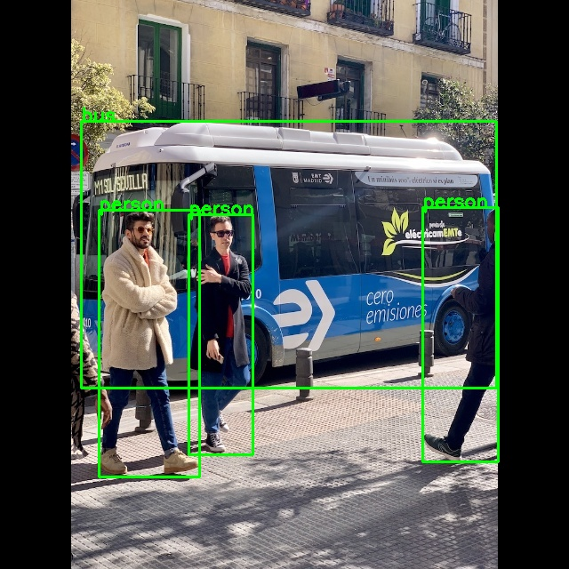

本例使用 YOLOv13-N 的六输出检测头。三个尺度各输出一组位置分布和一组类别 logits，应用需要先解码位置，再用 sigmoid 将类别值转为置信度。

## 导出三个尺度的六个检测头输出

YOLOv13-N 的每个尺度提供一组边界分布和一组类别分数。导出时保留这六个张量，推理端才能分别解码位置与类别。检测头按尺度输出边界和类别，板上的后处理程序按相同顺序取值。

```python
def forward(self, x):
    # 导出 onnx 增加
    y = []
    for i in range(self.nl):
        t1 = self.cv2[i](x[i])
        t2 = self.cv3[i](x[i])
        y.append(t1)
        y.append(t2)
    return y
```

## DshanPI A1 CM5 实测步骤与结果 {#cm5-实测步骤与结果}

### 在电脑上取得六输出模型

在 `Detect.forward` 中按尺度依次返回 `cv2`、`cv3` 的结果，导出并简化得到 `yolov13n-sim.onnx`。配套包中提供修改后的代码。 [配套源码（提取码 45r3）](https://pan.baidu.com/s/1ZqppMvmww0FPIrp7dJYBgA?pwd=45r3)

在已配置的 [RKNN 环境](./RKNNSetup.md) 中执行，按实际位置调整 ONNX 路径。

**在电脑上进入转换工具目录。**

```bash
source ~/rknn-env/bin/activate
cd ~/Projects/rknn_model_zoo/examples/yolov8/python
```

**转换模型。** 生成的板端文件为 `~/yolov13n.rknn`。

```bash
python convert.py ~/yolov13/yolov13n-sim.onnx rk3576 fp ~/yolov13n.rknn
```

将 `yolov13n.rknn`、Model Zoo 的 `examples/yolov8/model/bus.jpg` 和同目录的 `coco_80_labels_list.txt` 放到板上同一个目录。

### 在 DshanPI A1 CM5 上检测车辆与行人 {#在-cm5-上检测车辆与行人}

在该目录打开终端，执行以下示例。程序针对配套的 640 × 640 测试图。

**在板上启用 Lite2 环境。**

```bash
source ~/rknn-lite/bin/activate
```

**保存检测程序。** 整段复制到终端，直到最后单独一行的 `PY`，生成 `detect.py`。

```bash
cat > detect.py <<'PY'
import sys
import cv2
import numpy as np
from rknnlite.api import RKNNLite

model, path = sys.argv[1:]
image = cv2.imread(path)
assert image is not None and image.shape[:2] == (640, 640), "请使用示例的 640 × 640 bus.jpg"
npu = RKNNLite()
assert npu.load_rknn(model) == 0 and npu.init_runtime() == 0
outputs = npu.inference(inputs=[cv2.cvtColor(image, cv2.COLOR_BGR2RGB)[None, ...]])
npu.release()
assert len(outputs) == 6
boxes, scores, classes = [], [], []
for loc, cls in zip(outputs[::2], outputs[1::2]):
    _, _, h, w = loc.shape
    dist = loc[0].astype(np.float32).reshape(4, 16, h, w)
    weights = np.exp(dist - dist.max(axis=1, keepdims=True))
    dist = (weights * np.arange(16)[None, :, None, None]).sum(axis=1) / weights.sum(axis=1)
    cls = cls[0].astype(np.float32)
    labels = cls.argmax(axis=0)
    prob = 1 / (1 + np.exp(-np.clip(cls.max(axis=0), -60, 60)))
    for y, x in zip(*np.where(prob >= 0.5)):
        left, top, right, bottom = dist[:, y, x] * (640 / w)
        cx, cy = (x + 0.5) * 640 / w, (y + 0.5) * 640 / h
        boxes.append([float(cx-left), float(cy-top), float(left+right), float(top+bottom)])
        scores.append(float(prob[y, x]))
        classes.append(int(labels[y, x]))
with open("coco_80_labels_list.txt") as f:
    names = f.read().splitlines()
for label in sorted(set(classes)):
    ids = [i for i, c in enumerate(classes) if c == label]
    keep = cv2.dnn.NMSBoxes([boxes[i] for i in ids], [scores[i] for i in ids], 0.5, 0.45)
    for k in np.asarray(keep).flatten():
        i = ids[k]
        x, y, w, h = boxes[i]
        p, q = (round(x), round(y)), (round(x+w), round(y+h))
        print(names[label], round(scores[i], 3), p, q)
        cv2.rectangle(image, p, q, (0, 255, 0), 2)
        cv2.putText(image, names[label], p, cv2.FONT_HERSHEY_SIMPLEX, 0.7, (0, 255, 0), 2)
assert cv2.imwrite("yolov13-result.jpg", image)
PY
```

**运行检测。** 将模型和公交车图片交给刚保存的程序。

```bash
python detect.py yolov13n.rknn bus.jpg
```

本板找到一辆公交车和三个人，公交车分数为 **0.932**，左上角 `(91, 136)`，右下角 `(558, 436)`。打开 `yolov13-result.jpg` 检查标记位置。



### 用六输出模型处理图片和摄像头画面

将[DshanPI A1 CM5 示例代码包](pathname:///downloads/cm5-appdev-examples.zip)解压到主目录，得到 `~/cm5-examples/`。在上文保存 `yolov13n.rknn` 和 `bus.jpg` 的目录中打开终端。

**在板上启用 Lite2 环境。**

```bash
source ~/rknn-lite/bin/activate
```

**先测试配套图片。**

```bash
CM5_IMAGE=bus.jpg python ~/cm5-examples/yolov13_video.py yolov13n.rknn
```

**接入摄像头后再处理实时画面。** 将设备路径换成已确认的采集节点。

```bash
CM5_CAMERA=/dev/video42 python ~/cm5-examples/yolov13_video.py yolov13n.rknn
```

```text
bus 0.932 (91, 136) (558, 436)
output heads: 6
```

第一行是示例图中的公交车。实时运行时，连续三帧均打印 `output heads: 6`，对应三个尺度的定位和分类输出。导出 ONNX 和简化模型在电脑上完成。

**外接硬件**　图片模式无需外设。实时模式已接 OV13850。
