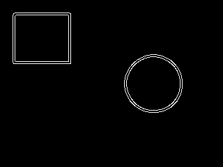

先用固定的矩形和圆测试算法，便于对照结果。Canny 找到亮度变化处的边缘，霍夫变换从边缘或灰度图中提取线段、圆，角点检测则找出两个方向亮度都明显变化的位置。

## 从摄像头画面中提取特征

OpenCV 在 Python 中用 NumPy 数组表示图像，在 C++ 中使用 `cv::Mat`。摄像头每返回一帧，程序就可以转换颜色、提取特征并把检测结果叠加回原图。先看各算法标记的对象，再对照 DshanPI A1 CM5 的固定图形实验。

## DshanPI A1 CM5 实测步骤与结果 {#cm5-实测步骤与结果}

### 安装并运行 Python 示例

**在板上安装 OpenCV 和开发工具。**

```bash
sudo apt install python3-opencv python3-numpy libopencv-dev g++ pkg-config
```

**保存图形检测程序。** 将下面整段复制到终端，生成 `shapes.py`。

```bash
cat > shapes.py <<'PY'
import cv2 as cv
import numpy as np
image = np.zeros((240, 320), np.uint8)
cv.rectangle(image, (20, 20), (100, 90), 255, 2)
cv.circle(image, (220, 120), 40, 255, 2)
edges = cv.Canny(image, 60, 120)
lines = cv.HoughLinesP(edges, 1, np.pi/180, 30, minLineLength=40, maxLineGap=5)
circles = cv.HoughCircles(image, cv.HOUGH_GRADIENT, 1, 50, param2=20, minRadius=32, maxRadius=48)
corners = cv.goodFeaturesToTrack(image, 20, 0.01, 10)
print(cv.__version__, "edges", cv.countNonZero(edges), "lines", len(lines), "circles", circles.shape[1], "corners", len(corners))
assert cv.imwrite("cm5-edges.png", edges)
PY
```

**运行检测。** 把输出与下方的结果对照。

```bash
/usr/bin/python3 shapes.py
```

本板使用 OpenCV 4.6.0，输出 `edges 1112 lines 8 circles 1 corners 20`。输出图中的白线是检测到的边缘。



### 验证 C++ 开发库

**保存 C++ 测试程序。** 整段复制，生成 `cv-version.cpp`。

```bash
cat > cv-version.cpp <<'EOF'
#include <opencv2/core.hpp>
#include <iostream>
int main() { std::cout << CV_VERSION << " " << cv::Mat::eye(2,2,CV_8U) << '\n'; }
EOF
```

**编译并运行。** 命令先链接 OpenCV，成功后执行版本测试。

```bash
g++ cv-version.cpp $(pkg-config --cflags --libs opencv4) -o cv-version && ./cv-version
```

程序会打印版本与一个 2 × 2 单位矩阵。扩展到摄像头时，可将每一帧转成灰度图，再复用上面的检测步骤。 [从视频管线读取图像](../Media/GStreamerOpenCV.md)

### 运行绘图与七个摄像头示例

将[DshanPI A1 CM5 示例代码包](pathname:///downloads/cm5-appdev-examples.zip)解压到主目录，得到 `~/cm5-examples/`。以下在桌面终端运行 Python 和 C++ 绘图程序，再逐项运行七个视觉示例。

**安装依赖并进入示例目录。**

```bash
sudo apt install python3-opencv libopencv-dev opencv-data g++ pkg-config
cd ~/cm5-examples
```

**运行 Python 绘图示例。**

```bash
/usr/bin/python3 hello.py
```

**编译并运行 C++ 绘图示例。**

```bash
g++ hello_opencv.cpp -o hello_opencv $(pkg-config --cflags --libs opencv4)
./hello_opencv
```

**用摄像头测试七种算法。** 先设定采集节点，再整段复制循环运行各个脚本。

```bash
export CM5_CAMERA=/dev/video42
for demo in canny lines circles rectangles regression corners faces; do
    /usr/bin/python3 "$demo.py" || break
done
```

Python 打印版本后显示蓝色画布，C++ 保存 400 × 200 的 `hello_opencv.jpg`。七个摄像头程序分别完成三帧处理。Canny 将原图和边缘图并排显示，因此输出宽度加倍。

```text
OpenCV Version: 4.6.0
Python Version: 3.12.3
OpenCV Ready！
```

```text
processed: (480, 1280, 3)
```

**外接硬件**　绘图程序无需摄像头。七个视觉示例已使用 OV13850 采集画面；几何图形和人脸的检出情况取决于镜头前的内容。
